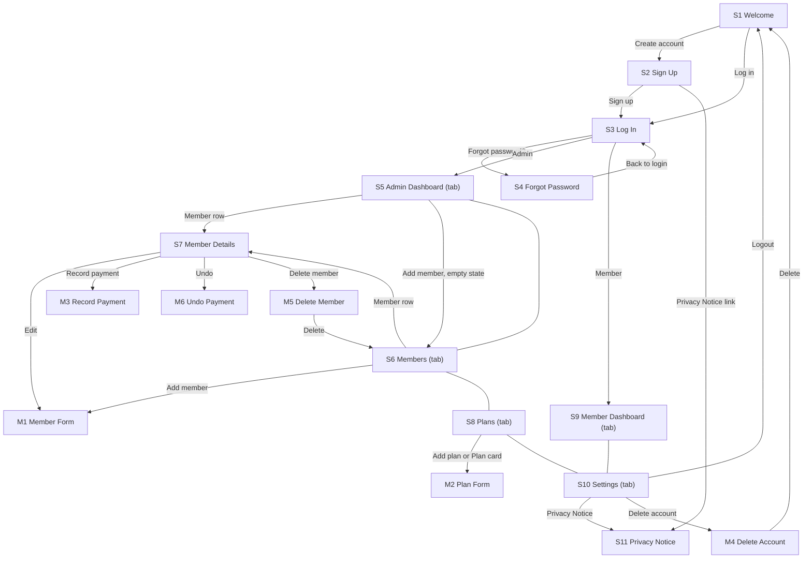

# IMPLEMENTATION_PLAN.md: STAY IN TRACK

---

## 0. Plan details

| Field | Value |
| --- | --- |
| App name | STAY IN TRACK |
| Built from PRD version | v1.0 (Approved, 4 Nov 2026). Changes from v0.1 are listed in the Change log of `docs/PRD.md`. |
| Screen designs | Stitch project "STAY IN TRACK" (style guide + S1–S11 + M1–M6); exported PNGs in `docs/designs/` (one file per S# and M#, e.g. `S1.png`, `M3.png`) |
| Plan version | v0.2 |
| Repository | https://github.com/analystmodikwe/Stay-In-Track |
| Status | Ready to build |
| Last updated | 4 Nov 2026 |

---

## 1. Start here (instructions for the coding agent)

Before writing any code:

1. Read this whole file from top to bottom.
2. Read `docs/PRD.md`.
3. Look at the screen designs listed in Section 7.3.
4. Check Section 18. If any clarification is still **Open**, stop and ask the human. Do not start.
5. Check that the prerequisites in Section 4.2 are installed.
6. Start **Phase 1 only**. Follow Section 2 at all times.

---

## 2. Rules for the coding agent (copy word for word, do not edit)

1. **One phase at a time.** Only work on the phase the human asked for. When that phase's Definition of Done is complete, stop and wait for the human to say "Start Phase <number>".
2. **Test-driven development (TDD) for every task.** Follow the cycle in Section 12.1:
    - Write the test.
    - Run it and see it fail for the right reason.
    - Write the smallest code that makes it pass.
    - Run all tests.
    - Refactor while all tests still pass.
3. **Never cheat a test.** Never delete, skip, weaken or change a test just to make it pass. If you believe a test is wrong, stop and explain why to the human.
4. **Never break earlier work.** Every test from earlier phases must still pass before a phase is done.
5. **Build only what is planned.** Build only what is in this file and `docs/PRD.md`. Never build anything in Section 3.3 (Deferred).
6. **Ask, don't guess.** If anything is missing, unclear or contradictory, stop, add it to Section 18, and ask the human.
7. **Match the designs.** Every screen must match its design in Section 7.3: layout, order, labels, text, colours and spacing. Use the design tokens in Section 7.1. Never hard-code colours, font sizes or spacing.
8. **Every state, every screen.** Each screen must handle every state listed for it in Section 7.3 (chosen from normal, empty, loading, error, offline, success, plus any screen-specific states).
9. **Exact wording.** Use the exact labels and messages from the PRD. Never invent wording.
10. **Security first.**
    - Never put secret keys in app code, logs, test files or Git.
    - Every permission rule in Section 9 must be enforced on the server or database, never only in the app.
    - Every permission rule must have a test.
11. **Full check before "done".** Run the full check command (Section 4.3) before saying a phase is done, then add a short summary of the results to the Progress log (Section 17).
12. **Record your progress.** After each phase:
    - tick the checkboxes for that phase in this file;
    - add a row to the Progress log;
    - commit using the commit message given in the phase.
13. **No surprise libraries.** Do not add, remove or upgrade any library or tool not listed in Section 4.1 without asking the human first.
14. **Stuck rule.** If the same problem is still failing after 3 attempts, stop and report:
    - what you tried;
    - the exact error;
    - what you need from the human.
15. **Clean code.** Follow the folder structure in Section 5. Use the PRD's key terms (Section 3.4) for names in code. Keep files small and focused.

---

## 3. Project summary and scope

### 3.1 Summary

STAY IN TRACK helps small, independent gym owners in South Africa track member payments, so unpaid Members no longer enter for free. The Admin (gym owner or manager) adds Plans and Members and records each Payment; the app calculates every Member's Status (Active, Grace period or Overdue) and shows revenue on a Dashboard. Members log in to see their own Status, Plan, Benefits and Payment history.

**Platform:** Web app, mobile-first (390px phone browser first, then tablet and desktop). Deployed on Vercel.

### 3.2 Features in scope

| ID | Feature | Priority | Built in phase |
| --- | --- | --- | --- |
| F1 | Account (US1–US4) | Must | 3 (US1, US2, US4), 5 (US3: Member sign-up needs Members to exist) |
| F2 | Member management | Must | 5 |
| F3 | Plans and payments | Must | 4 (Plans, Grace period: US7, US10), 6 (Payments: US8, US9) |
| F4 | Entrance Status check | Must | 7 |
| F5 | Admin Dashboard | Must | 7 |
| F6 | Member Dashboard | Should | 8 |
| F7 | Payment reminders | Should | 8 |

### 3.3 Deferred: do NOT build

- Online payments (PayFast, Yoco, Ozow); Payments are only recorded by the Admin
- Gate, turnstile, card or QR integration
- Attendance or check-in logs
- Staff accounts and multi-gym owners (one Admin account per gym)
- Native Android or iPhone app
- Email, SMS or push notifications (only the account emails in PRD Section 5 and in-app banners)
- Member requests to pay in advance
- Changing email or phone on the account (not in v1)
- Dark mode
- Plan delete button (Plans can only be made Inactive)
- Editing a Payment (only undoing the latest one, BR6)
- Photos, profile pictures and decorative illustrations
- Any Stitch design extra that is not in the PRD (see Section 18, #4)

### 3.4 Key terms (use these names in code)

| Term (PRD 1.7) | Name in code | Meaning |
| --- | --- | --- |
| Admin | `admin`, `profiles.role = 'admin'` | Gym owner or manager; also used by staff at the entrance |
| Member | `Member`, table `members` | Person who trains at the gym; record added by the Admin |
| Gym | `Gym`, table `gyms` | One gym run by one Admin |
| Profile | `Profile`, table `profiles` | One login account (Admin or Member) |
| Plan | `Plan`, table `plans` | Package with name, monthly price in rand and Benefits |
| Payment | `Payment`, table `payments` | One amount received for 1–12 months (BR5) |
| Status | `Status`, `memberStatus()` | `active`, `grace`, `overdue`; always calculated, never stored (BR3) |
| Grace period | `grace_days` on `gyms` | Days after `paid_until` during which a Member keeps access (BR4) |
| Benefit | `benefits` on `plans` | Plain-text list on the Plan |
| Dashboard | S5 (Admin), S9 (Member) | Home screen of a role |

---

## 4. Tech stack, prerequisites and commands

### 4.1 Stack

| Layer | Tool | Version | Used for |
| --- | --- | --- | --- |
| Frontend | React with Vite and React Router | React 18.3, Vite 5, React Router 6 | Screens, modals and routing |
| Language | TypeScript (strict mode), npm | Latest stable at setup | All app, test and script code |
| Runtime | Node.js | 20 LTS | Running tools and scripts |
| Styling | Tailwind CSS | 3.4 | Styling with the design tokens |
| Fonts | `@fontsource/inter` | Latest stable at setup | Inter font (self-hosted, no extra requests) |
| Icons | `lucide-react` | Latest stable at setup | Lucide outline icons (PRD 9.1) |
| Backend and database | Supabase: PostgreSQL, Auth, Row-Level Security | Supabase CLI latest; `@supabase/supabase-js` v2 | Data, log-in, permissions |
| Server functions | None | — | All server logic is database functions and triggers |
| Data fetching and caching | None (plain `supabase-js` calls in `src/lib/api/`) | — | Keeps the initial bundle under 300 KB |
| Unit tests | Vitest | Latest stable at setup | BR3, BR5, BR6, BR7 and all other `src/lib` rules |
| Component tests | Vitest + React Testing Library + jsdom | Latest stable at setup | Components and screens in every state, with fake data |
| Database and permission tests | pgTAP via `supabase test db` | Supabase CLI | Constraints, triggers, functions, RLS |
| Integration tests | Vitest + `supabase-js` against the local Supabase | — | Operations OP1–OP22 |
| End-to-end tests | Playwright (Chromium, 390px phone viewport and desktop) | Latest stable at setup | User flows from PRD Section 7.1 |
| Lint and type check | ESLint, TypeScript compiler (`tsc`) | Latest stable at setup | Code quality |
| Secret scan | secretlint | Latest stable at setup | Finds keys accidentally committed |
| Build and hosting | Vite build, Vercel (public URL) | Latest | Demo deployment |

The tools marked in Section 18 #2 are not named in PRD 11.1; they were approved in Section 18 #2. Dates and money use the built-in `Intl` API with the `Africa/Johannesburg` time zone; no date library is added.

### 4.2 Prerequisites on the computer

- [ ] Node.js 20 LTS and npm
- [ ] Git and a GitHub account
- [ ] Docker Desktop, running (the local Supabase needs it)
- [ ] Chrome (for manual testing on a phone-sized screen and on a laptop)
- [ ] An Android phone on the same Wi-Fi, to open the app on a real phone
- [ ] Accounts: Supabase (hosted project) and Vercel (deployment)

### 4.3 Commands

| Purpose | Command |
| --- | --- |
| Install dependencies | `npm install` |
| Start the local backend | `npx supabase start` |
| Reset the database (migrations + seed data) | `npx supabase db reset` then `npm run seed` (= `node --env-file=.env supabase/seed/seed.ts`) |
| Start the app | `npm run dev` |
| Unit and component tests | `npm test` (= `vitest run --exclude tests/integration`) |
| Database and permission tests | `npx supabase test db` |
| Integration tests | `npm run test:integration` (= `vitest run --config vitest.integration.config.ts`, reads `.env`) |
| End-to-end tests | `npx playwright test` (the app and the local backend must be running) |
| Lint | `npm run lint` |
| Type check | `npx tsc --noEmit` |
| **Full check (run before every "done")** | `npm run check` (runs lint, type check, `npm test`, `supabase test db` and `test:integration`). `npx supabase start` must already be running. |
| Build for release | `npm run build` (the output folder is checked for the 300 KB rule in T-NFR-5) |

End-to-end tests (Playwright) are run at the end of each feature phase and in Phase 9. They are not part of `npm run check`, because they need the running app and a browser.

---

## 5. Folder structure

```
stay-in-track/
  src/
    pages/                 One file per full screen: S1 Welcome.tsx, S2 SignUp.tsx, S3 LogIn.tsx,
                           S4 ForgotPassword.tsx, S5 AdminDashboard.tsx, S6 Members.tsx,
                           S7 MemberDetails.tsx, S8 Plans.tsx, S9 MemberDashboard.tsx,
                           S10 Settings.tsx, S11 PrivacyNotice.tsx
    modals/                M1 MemberForm.tsx, M2 PlanForm.tsx, M3 RecordPayment.tsx,
                           M4 DeleteAccount.tsx, M5 DeleteMember.tsx, M6 UndoPayment.tsx
    components/            Header, TabBar, SideMenu, Button, TextField, SelectField, Checkbox,
                           Toggle, StatusBadge, MemberRow, StatCard, PlanCard, PaymentRow,
                           NoticeBanner, Toast, ConfirmModal, EmptyState, LoadingPlaceholder,
                           OfflineBanner
    theme/tokens.ts        Design tokens (Section 7.1); tailwind.config.ts reads this file
    hooks/                 useSession, useOnline (offline detection), useToast
    lib/
      supabase.ts          Supabase client (public key only)
      status.ts            memberStatus() (BR3)
      payments.ts          newPaidUntil(), canUndo() (BR5, BR6)
      revenue.ts           revenueThisMonth() (BR7)
      reminders.ts         which notice shows on S9 (BR10)
      rules/               Pure validation functions: password, plan, member, payment, grace
      format.ts            Rand, date and phone formats (SAST)
      messages.ts          Every user-facing message from the PRD, in one place
      api/                 One file per operation group (Section 10)
    App.tsx                Router and access guards (Section 11)
    main.tsx
  supabase/
    migrations/            SQL migrations (Section 8.6)
    tests/                 pgTAP tests (T-DB, T-BR, T-SEC)
    seed/seed.ts           Seed script (uses the secret key; never in the app)
    seed/README.md         Test accounts and how to seed
  tests/
    unit/                  src/lib rules (T-BR, T-AUTH, T-NFR)
    components/            T-C and screen-state tests
    integration/           Operation tests against local Supabase
    e2e/                   Playwright flows (T-E2E)
  docs/PRD.md
  docs/designs/            Exported designs: S1.png … S11.png, M1.png … M6.png
  IMPLEMENTATION_PLAN.md
  vercel.json              Rewrites all paths to index.html (single-page app)
  .env.example
  README.md
```

**Rule:** a new folder may only be created if it is added to this section first.

---

## 6. Environment variables and secrets

| Name | What it is | Where to get it | Public or secret | Used by |
| --- | --- | --- | --- | --- |
| `VITE_SUPABASE_URL` | Project address | Local: `http://127.0.0.1:54321` (from `npx supabase status`). Hosted: Supabase dashboard → Project Settings → API | Public | App |
| `VITE_SUPABASE_ANON_KEY` | Public (anon / publishable) key | Same | Public. Safe only because RLS is on for every table. | App |
| `SUPABASE_URL` | Project address as scripts and tests see it | Same as above | Public | Seed script and integration tests only |
| `SUPABASE_SERVICE_ROLE_KEY` | Admin (service role / secret) key | Same | **Secret** | `supabase/seed/seed.ts` and integration tests only |
| `SEED_TEST_PASSWORD` | Test-only password for all seed accounts | You choose it | **Secret** | Seed script, integration tests, Playwright |
| `.env.hosted-test` (a file, same variable names) | Values for the second hosted project `stay-in-track-test`, including its service-role key, used only to seed it and run the Phase 10 end-to-end run | Supabase dashboard of `stay-in-track-test` | **Secret** | `npm run seed` and Playwright in T-REL-2 only |

`.env.example` (committed to Git, placeholder values only):

```
VITE_SUPABASE_URL=http://127.0.0.1:54321
VITE_SUPABASE_ANON_KEY=replace-with-anon-key
SUPABASE_URL=http://127.0.0.1:54321
SUPABASE_SERVICE_ROLE_KEY=replace-with-service-role-key-never-commit
SEED_TEST_PASSWORD=replace-with-a-test-only-password
```

Rules:

- Real values go in `.env` and `.env.hosted-test`. `.gitignore` contains `.env*` followed by `!.env.example`, so every real env file is ignored and only `.env.example` is committed. A check in Phase 1 proves `git status` does not show `.env.hosted-test`.
- Only variables starting with `VITE_` may be used in `src/`. A test (T-NFR-6) fails if `SERVICE_ROLE` appears in `src/`.
- To open the app on a real phone, run `npm run dev -- --host` and use your computer's Wi-Fi IP address; `VITE_SUPABASE_URL` must then also use that IP address, not `127.0.0.1`.
- Secret values are never used in app code. They are used only in the seed script and integration tests, read from `.env`.
- If a new variable is needed, add it here and to `.env.example` first.

---

## 7. Design system and screens

### 7.1 Design tokens (`src/theme/tokens.ts`)

Where the PRD and the Stitch style guide differ, the PRD wins (see Section 18, #3).

| Token | Value | From PRD |
| --- | --- | --- |
| `color.primary` | #1F3A5F (navy) | 9.1 Primary colour |
| `color.accent` | #0F766E (teal; links, toggles, filter chips, focus ring) | 9.1 Secondary colour |
| `color.background` | #F5F7FA | 9.1 |
| `color.surface` | #FFFFFF | 9.1 |
| `color.text` | #111827 | 9.1 Main text |
| `color.textSecondary` | #4B5563 | 9.1 |
| `color.border` | #CBD5E1 | Style guide 2.2 (PRD 9.1 gives no border colour) |
| `color.error` / `color.success` / `color.warning` | #C62828 / #2E7D32 / #7A4B00 | 9.1 |
| `color.badge.active` (background / text) | #E3F4E6 / #1B5E20 | 9.1 Status badge colours |
| `color.badge.grace` (background / text) | #FFF3CD / #7A4B00 | 9.1 |
| `color.badge.overdue` (background / text) | #FBE3E3 / #9B1C1C | 9.1 |
| `color.toast` | #111827 background, white text | 8.3 Toast |
| `font.family` | Inter | 9.1 |
| `font.title` | 22px bold | 9.1 Text sizes |
| `font.heading` | 18px semibold | 9.1 |
| `font.body` | 16px regular | 9.1 |
| `font.small` | 13px regular (never below 12px) | 9.1, 9.4 |
| `font.stat` | 28px bold | 9.1 |
| `space.1` / `space.2` / `space.3` / `space.4` | 8 / 16 / 24 / 32 px | 9.1 Spacing unit 8px |
| `space.screen` | 16px side margin | 9.1 |
| `radius.card` / `radius.input` / `radius.button` / `radius.badge` | 12 / 8 / 8 / full | 9.1 |
| `shadow.card` | 0 1px 3px rgba(0,0,0,0.12), on cards only | 9.1 |
| `size.button` | 48px | 9.1 |
| `size.touchMin` | 44px | 9.4 |
| `focus.ring` | 2px solid #0F766E | 9.3 |
| `breakpoint.tablet` / `breakpoint.desktop` | 640px / 1024px | 9.3 |
| `layout.sideMenuWidth` / `layout.maxContent` / `layout.modalWidth` | 240px / 1200px / 480px | 9.3 |

### 7.2 Shared components

| Component | File | Variants and states | Used on | Tests |
| --- | --- | --- | --- | --- |
| Button | `components/Button.tsx` | primary, secondary (outlined), danger; disabled; loading (spinner); 48px tall | All | T-C-1 |
| TextField | `components/TextField.tsx` | normal, focused (2px teal ring), error (red border + message); password with eye icon | S2–S4, S10, M1–M3 | T-C-2 |
| SelectField, Checkbox, Toggle | `components/SelectField.tsx`, `Checkbox.tsx`, `Toggle.tsx` | normal, error, disabled | S2, S10, M1–M3 | T-C-3 |
| Toast | `components/Toast.tsx` | one line, dark background, disappears after 3 s | All logged-in screens | T-C-4 |
| OfflineBanner | `components/OfflineBanner.tsx` | shown when offline: "You're offline. Changes will not be saved." | All logged-in screens | T-C-5 |
| EmptyState | `components/EmptyState.tsx` | line icon, text, optional button | S5, S6, S8, S9 | T-C-6 |
| LoadingPlaceholder | `components/LoadingPlaceholder.tsx` | grey rounded blocks (card, row, block) | All lists | T-C-7 |
| ConfirmModal | `components/ConfirmModal.tsx` | title, text, danger button, "Cancel"; tapping outside closes it | M4, M5, M6 | T-C-8 |
| NoticeBanner | `components/NoticeBanner.tsx` | icon + text on tinted background; not tappable | S3, S9 | T-C-9 |
| Header | `components/Header.tsx` | back arrow or close icon, title, optional subtitle; hidden on S1 | S2–S11, M1–M3 | T-C-10 |
| StatusBadge | `components/StatusBadge.tsx` | check-circle "Active" (green), clock "Grace period" (amber), alert-circle "Overdue" (red); icon and text always shown | S5, S6, S7, S9 | T-C-11 |
| TabBar / SideMenu | `components/TabBar.tsx`, `SideMenu.tsx` | Admin: Dashboard, Members, Plans, Settings. Member: Home, Settings. Active item filled in primary colour. Tab bar under 640px; side menu from 640px | S5, S6, S8, S9, S10 | T-C-12 |
| MemberRow | `components/MemberRow.tsx` | full name, Plan name, StatusBadge, "Paid until 15 Nov 2026" or "No Payment yet"; tap → S7 | S5, S6 | T-C-13 |
| StatCard | `components/StatCard.tsx` | label, large number; not tappable | S5 | T-C-14 |
| PlanCard | `components/PlanCard.tsx` | name, "R350.00 per month", Benefits, "Active"/"Inactive", Member count; tap → M2 | S8 | T-C-15 |
| PaymentRow | `components/PaymentRow.tsx` | date, amount, method, months; optional "Undo" | S7, S9 | T-C-16 |

### 7.3 Screens

Every screen also has the Offline state (banner under the Header, last loaded data stays visible, every save button disabled) and the Error state ("Something went wrong. Try again." with a "Try again" button), as required by PRD 8.2. They are listed below as "Offline" and "Error".

| ID | Screen | Route / file | Design | Who can open it (else redirect to) | Tab bar | Required states | Phase |
| --- | --- | --- | --- | --- | --- | --- | --- |
| S1 | Welcome | `/` · `pages/Welcome.tsx` | `docs/designs/S1.png` | Logged out (else own Dashboard) | No | Normal | 1 |
| S2 | Sign Up | `/sign-up` | S2.png | Logged out (else own Dashboard) | No | Normal, Loading, Error, Offline, Success | 3 (Admin), 5 (Member) |
| S3 | Log In | `/log-in` | S3.png | Logged out (else own Dashboard) | No | Normal, Loading, Error, Offline, Success (verify banner) | 3 |
| S4 | Forgot Password | `/forgot-password` | S4.png | Logged out, or opened from the reset email link | No | Normal, Loading, Error, Offline, Success | 3 |
| S5 | Admin Dashboard | `/dashboard` | S5.png | Admin (Member → S9) | Yes | Normal, Empty ("No Members yet…"), Overdue list empty, Loading, Error, Offline | 3 (placeholder), 7 |
| S6 | Members | `/members` | S6.png | Admin (Member → S9) | Yes | Normal, Empty, No search results, Loading, Error, Offline, Success (toasts) | 3 (placeholder), 5 (list), 7 (search, filters) |
| S7 | Member Details | `/members/:id` | S7.png | Admin (Member → S9) | No | Normal, No Payments yet, Loading, Error, Offline, Success (toasts) | 5 (details), 6 (Payments) |
| S8 | Plans | `/plans` | S8.png | Admin (Member → S9) | Yes | Normal, Empty, Loading, Error, Offline, Success | 3 (placeholder), 4 |
| S9 | Member Dashboard | `/home` | S9.png | Member (Admin → S5) | Yes | Normal, No Payments yet, Notice banners, Loading, Error, Offline, Record removed | 3 (placeholder), 8 |
| S10 | Settings | `/settings` | S10.png | Admin, Member | Yes | Normal, Loading, Error, Offline, Success (toasts) | 3 (shell), 4 (Grace period), 8 (reminders) |
| S11 | Privacy Notice | `/privacy` | S11.png | Logged out and logged in | No | Normal | 3 |
| M1 | Member Form | modal over S6 / S7 | M1.png | Admin | — | Normal (add, edit), Loading, Error (field errors), Offline | 5 |
| M2 | Plan Form | modal over S8 | M2.png | Admin | — | Normal (add, edit), Loading, Error, Offline | 4 |
| M3 | Record Payment | modal over S7 | M3.png | Admin | — | Normal, Loading, Error, Offline, Session expired | 6 |
| M4 | Delete Account | modal over S10 | M4.png (Admin and Member variants) | Admin, Member | — | Normal, Loading, Offline | 3 |
| M5 | Delete Member | modal over S7 | M5.png | Admin | — | Normal, Loading, Offline | 5 |
| M6 | Undo Payment | modal over S7 | M6.png | Admin | — | Normal, Loading, Offline | 6 |

Where a Stitch prompt uses different wording from the PRD (for example "Sign Up" instead of "Create account" on S1), the PRD wording is used (Rule 9).

---

## 8. Data model and database

All tables live in the `public` schema. `profiles.id` is the same as the Supabase Auth user id. Times are saved in UTC (`timestamptz`) and shown in SAST; `date` columns are calendar dates in SAST. "Cascade" means the row is deleted when the row it points to is deleted.

### 8.1 Tables

**Table: `gyms`**: one gym run by one Admin.

| Column | Type | Null? | Default | Constraints | Notes |
| --- | --- | --- | --- | --- | --- |
| id | uuid | No | gen_random_uuid() | primary key | |
| name | text | No | — | length 2–60 | |
| grace_days | integer | No | 3 | between 0 and 14 | BR4 |
| created_at | timestamptz | No | now() | | |

**Table: `profiles`**: one login account.

| Column | Type | Null? | Default | Constraints | Notes |
| --- | --- | --- | --- | --- | --- |
| id | uuid | No | — | primary key; foreign key → `auth.users.id` on delete cascade | Created by `handle_new_user` |
| email | text | No | — | unique; `email = lower(email)`; length ≤ 100 | |
| full_name | text | No | — | length 2–60 | |
| role | text | No | — | check in ('admin', 'member') | Set at sign-up |
| gym_id | uuid | No | — | foreign key → gyms on delete cascade | |
| is_18_or_older | boolean | No | — | check = true | |
| reminders_on | boolean | No | true | | Used only by Members (BR10) |
| created_at | timestamptz | No | now() | | |

**Table: `plans`**: one membership package.

| Column | Type | Null? | Default | Constraints | Notes |
| --- | --- | --- | --- | --- | --- |
| id | uuid | No | gen_random_uuid() | primary key | |
| gym_id | uuid | No | — | foreign key → gyms on delete cascade | |
| name | text | No | — | length 2–30; unique on `(gym_id, lower(name))` | BR1 |
| price | numeric(12,2) | No | — | between 1.00 and 5000.00 | BR1 |
| benefits | text | Yes | — | length ≤ 300 | BR1 |
| status | text | No | 'active' | check in ('active', 'inactive') | BR1 |
| created_at | timestamptz | No | now() | | |

**Table: `members`**: one person with a membership at a gym.

| Column | Type | Null? | Default | Constraints | Notes |
| --- | --- | --- | --- | --- | --- |
| id | uuid | No | gen_random_uuid() | primary key | |
| gym_id | uuid | No | — | foreign key → gyms on delete cascade | |
| user_id | uuid | Yes | — | unique; foreign key → profiles on delete set null | Set when the Member signs up (BR8) |
| full_name | text | No | — | length 2–60 | BR2 |
| email | text | No | — | `email = lower(email)`; length ≤ 100; unique on `(gym_id, email)` | BR2 |
| phone | text | Yes | — | check `phone ~ '^\+27[0-9]{9}$'` (spaces are removed before saving) | BR2 |
| plan_id | uuid | No | — | foreign key → plans, NO ACTION on delete (blocks a Plan delete while Members use it) | Active Plan only for new assignments (BR1) |
| paid_until | date | Yes | — | | Set by Payments (BR5, BR6) |
| is_18_or_older | boolean | No | — | check = true | BR2 |
| created_at | timestamptz | No | now() | | |

**Table: `payments`**: one amount received from a Member.

| Column | Type | Null? | Default | Constraints | Notes |
| --- | --- | --- | --- | --- | --- |
| id | uuid | No | gen_random_uuid() | primary key | |
| gym_id | uuid | No | — | foreign key → gyms on delete cascade | |
| member_id | uuid | No | — | foreign key → members on delete cascade | |
| amount | numeric(12,2) | No | — | between 1.00 and 50000.00 | BR5 |
| method | text | No | — | check in ('Cash', 'EFT', 'Card') | |
| months | integer | No | 1 | between 1 and 12 | BR5 |
| payment_date | date | No | today in SAST | not in the future (trigger `payment_date_not_future`) | BR5 |
| previous_paid_until | date | Yes | — | | Saved for Undo (BR6) |
| recorded_by | uuid | Yes | auth.uid() | foreign key → profiles on delete set null | PRD says required, but also "clear the field" on delete (Section 18, #11) |
| created_at | timestamptz | No | now() | | Used for the 24-hour Undo rule (BR6) |

### 8.2 Relationships and delete behaviour

- One gym has many profiles, plans, members and payments (all cascade when the gym is deleted).
- One plan has many members. A Plan cannot be deleted while Members use it; the app has no Plan delete in v1 anyway.
- One member has many payments (cascade, BR11).
- One profile (role `member`) links to at most one member through `members.user_id`.
- Deleting a profile sets `members.user_id` and `payments.recorded_by` to empty.
- Deleting a member deletes its payments but keeps the Member's profile; the Member sees "Your membership record was removed. Please contact your gym." on next log-in (BR11).
- `delete_my_account()` deletes the Auth user(s) first, then the gym (Section 8.5).

### 8.3 Status changes

| Table.column | From | To | Triggered by | Enforced by |
| --- | --- | --- | --- | --- |
| plans.status | active | inactive | Admin turns "Active" off in M2 | Check constraint; RLS (SEC9) |
| plans.status | inactive | active | Admin turns "Active" on in M2 | Same |
| Member Status (calculated, not saved) | Overdue | Active | A Payment makes `paid_until` today or later | `member_status()` (BR3, BR5) |
| Member Status (calculated, not saved) | Active | Grace period | The day after `paid_until` passes | `member_status()` |
| Member Status (calculated, not saved) | Grace period | Overdue | Grace days run out, or Admin lowers the Grace period | `member_status()` (BR3, BR4) |
| Member Status (calculated, not saved) | Active or Grace period | Overdue | Admin undoes the only Payment | `undo_payment()` (BR6) |

### 8.4 Indexes

- `members (gym_id, lower(full_name), id)`: Members list, search and A–Z paging (BR9)
- `members (gym_id, lower(email))`: search by email and the sign-up link lookup (BR8)
- `members (plan_id)`: Member count per Plan
- `payments (member_id, created_at desc)`: Payment history and "latest Payment"
- `payments (gym_id, payment_date)`: revenue this month (BR7)
- `plans (gym_id)` and `profiles (gym_id)`: gym isolation checks

### 8.5 Automatic jobs and triggers

No scheduled jobs: Status is calculated when shown (BR3). All functions have `set search_path = ''`. Functions marked "definer" run as the database owner because they must work past RLS; all others are "invoker", so RLS applies.

| Name | Runs when | What it does | BR# | Test |
| --- | --- | --- | --- | --- |
| `handle_new_user` (definer) | After insert on `auth.users` | Reads sign-up data. Admin: creates the gym (grace_days 3) and the profile. Member: finds the unlinked Member with that email, creates the profile in that gym and sets `members.user_id`; raises `member_not_found` if there is none. Rejects users who are not 18 or older. | BR8, BR12 | T-DB-2, T-DB-3, T-BR8-1 |
| `can_sign_up_as_member(email)` (definer) | Called before Member sign-up (allowed for `anon`) | Returns true or false only: an unlinked Member with this email exists at some gym | BR8 | T-BR8-1 |
| `limit_members` | Before insert on `members` | Raises `member_limit` when the gym already has 500 Members | BR2 | T-BR2-2 |
| `member_plan_active` | Before insert, and before update when `plan_id` changes, on `members` | Raises `plan_inactive` unless the Plan is Active and in the same gym | BR1, BR2 | T-BR1-2, T-BR2-3 |
| `lock_linked_member_email` | Before update on `members` | Raises `email_locked` if `user_id` is set and the email changes | BR8 | T-BR8-3 |
| `payment_date_not_future` | Before insert on `payments` | Raises `future_date` if `payment_date` is after today in SAST | BR5 | T-BR5-4 |
| `member_status(paid_until, grace_days, today)` | Called by queries | Returns 'active' (`paid_until >= today`), 'grace' (`today <= paid_until + grace_days`) or 'overdue' (later, or no `paid_until`) (BR3). The last Grace day is `paid_until` + `grace_days`, counted in. | BR3 | T-BR3-1 |
| `list_members(search, status, cursor, today)` | Called by S6 and S5 | Members of the caller's gym, 20 at a time, A–Z, with Status | BR9 | T-BR9-1, T-BR9-2 |
| `get_dashboard(today)` | Called by S5 | Total, Active, Grace period, Overdue, revenue this month, Members per Plan, first 5 Overdue Members | BR3, BR7 | T-DB-4, T-BR7-1 |
| `record_payment(member_id, months, amount, method, payment_date)` (invoker) | Called by M3 | In one transaction: saves `previous_paid_until`, inserts the Payment, sets the new `paid_until` | BR5 | T-BR5-1 to T-BR5-5 |
| `undo_payment(payment_id)` (invoker) | Called by M6 | Only if it is the latest Payment and under 24 hours old: deletes it and restores `paid_until` | BR6 | T-BR6-1 to T-BR6-3 |
| `delete_my_account()` (definer) | Called by M4 | Admin: deletes the Auth users of the whole gym, then the gym (cascade). Member: deletes only the caller's Auth user (the Member record and Payments stay). Always acts on `auth.uid()` only. | BR11, BR12 | T-DB-5, T-DB-6, T-SEC-19a/b |
| `current_gym_id()`, `is_admin()` (definer) | Used inside RLS policies | Return the caller's gym and whether the caller is its Admin | BR12 | T-SEC-17a/b |

### 8.6 Migrations (in order)

1. `0001_tables.sql`: all tables, constraints and indexes in 8.1 and 8.4
2. `0002_helpers.sql`: `current_gym_id()`, `is_admin()`, `today_sast()`, `member_status()`
3. `0003_rls.sql`: RLS on for every table; all policies and column privileges in Section 9
4. `0004_triggers.sql`: all triggers in 8.5 and `handle_new_user`, attached to `auth.users`
5. `0005_functions.sql`: `can_sign_up_as_member`, `list_members`, `get_dashboard`, `record_payment`, `undo_payment`, `delete_my_account`, with their execute rights (SEC18)

### 8.7 Seed data and test accounts

- **Seed script:** `supabase/seed/seed.ts` (run with `npm run seed`). It loads the sample data set from PRD 8.4 for today = 28 Oct 2026: gym Iron Haven Gym (grace 3 days), Plans Student R250.00, Standard R350.00, Premium R550.00, Members Naledi Khumalo, Johan van der Merwe, Thando Mokoena, Ayesha Patel, and their 4 Payments (revenue this month R1,350.00). It creates Auth users with the admin API (email confirmed), so the `handle_new_user` trigger builds the gym, profiles and links.
- **Test accounts** (one per role; passwords all come from `SEED_TEST_PASSWORD`, listed only in `supabase/seed/README.md`, never in this file):
    - Admin: sipho@ironhaven.example.com
    - Member: naledi.k@example.com (Active)
    - Member: thando.m@example.com (Grace period)
- Ayesha Patel and Johan van der Merwe have no accounts (used for Overdue and Active lists).
- **Fixed "today" in tests:** status and revenue functions take a `today` value, so tests use 28 Oct 2026 and never depend on the real date.
- pgTAP tests build their own fixtures inside a transaction (two gyms, so isolation can be tested) and roll back.

---

## 9. Security and permissions

`current_gym_id()` and `is_admin()` are described in Section 8.5. "Admin of that gym" means `is_admin()` and the row's `gym_id = current_gym_id()`.

| ID | Table / resource | Action | Who is allowed | Rule | Enforced by | Tests (allow / deny) |
| --- | --- | --- | --- | --- | --- | --- |
| SEC1 | gyms | read | Admin and Members of that gym | Only their own gym (BR12) | RLS select policy | T-SEC-1a / 1b |
| SEC2 | gyms | update | Admin of that gym | `grace_days` 0–14 (BR4) | RLS + check constraint | T-SEC-2a / 2b |
| SEC3 | gyms | create | Nobody directly | Created only by `handle_new_user` | No insert policy | T-SEC-3b |
| SEC4 | gyms | delete | Nobody directly | Only through `delete_my_account()` (M4) | No delete policy | T-SEC-4b |
| SEC5 | profiles | read | Owner only | `id = auth.uid()` | RLS | T-SEC-5a / 5b |
| SEC6 | profiles | update | Owner only | Members and Admins can change only `reminders_on` (role, gym, email, age cannot change) | RLS + column privileges | T-SEC-6a / 6b |
| SEC7 | profiles | delete | Nobody directly | Only through `delete_my_account()` | No delete policy | T-SEC-7b |
| SEC8 | plans | read | Admin: all Plans of the gym. Member: only their own Plan | BR12 | RLS | T-SEC-8a / 8b |
| SEC9 | plans | create / update | Admin of that gym | BR1 | RLS with check | T-SEC-9a / 9b |
| SEC10 | plans | delete | Nobody | No Plan delete in v1 | No delete policy | T-SEC-10b |
| SEC11 | members | read | Admin: all Members of the gym. Member: only their own record | BR12 | RLS | T-SEC-11a / 11b |
| SEC12 | members | create / update / delete | Admin of that gym | BR2, BR8, BR11 | RLS with check | T-SEC-12a / 12b |
| SEC13 | payments | read | Admin: all Payments of the gym. Member: only their own | BR12 | RLS | T-SEC-13a / 13b |
| SEC14 | payments | create | Admin of that gym | BR5 | RLS with check (through `record_payment`) | T-SEC-14a / 14b |
| SEC15 | payments | delete | Admin of that gym | Only the Member's latest Payment, only within 24 hours (BR6) | RLS delete policy + `undo_payment` | T-SEC-15a / 15b |
| SEC16 | payments | update | Nobody | Payments are never edited (BR6) | No update policy | T-SEC-16b |
| SEC17 | every table | read / write | Own gym only | A user of gym A can never read or change gym B data (BR12) | RLS on all tables | T-SEC-17a / 17b |
| SEC18 | database functions | execute | `can_sign_up_as_member`: anon + authenticated. All others: authenticated only | Execute rights revoked from `public`; definer functions have fixed `search_path` | `revoke` / `grant` in `0005` | T-SEC-18a / 18b |
| SEC19 | `delete_my_account()` | call | Logged-in user, for their own account only | Uses `auth.uid()`; accepts no user id | Function code | T-SEC-19a / 19b |
| SEC20 | profiles | create | Nobody directly | Created only by `handle_new_user` | No insert policy | T-SEC-20b |

**Always-on security checks** (tested in Phase 9):

- [ ] T-DB-7: a database test lists every table in `public` and fails if any has RLS switched off.
- [ ] Input is checked in the app (`src/lib/rules`) **and** in the database (constraints in 8.1).
- [ ] The limits BR2 (500 Members), BR5 (payment date, amount, months) and BR6 (24-hour Undo) are enforced by database triggers, functions and policies, not only in the app.
- [ ] The 5-wrong-passwords lock is enforced by Supabase Auth rate limits, not only in the app (Section 18, #6).
- [ ] No passwords, tokens or emails are written to logs (T-NFR-7).
- [ ] A secret scan (`npx secretlint "**/*"`) finds no keys (T-NFR-6).
- [ ] Payment data holds only amount, date, method and months; no card numbers or bank details are ever stored.

---
## 10. Backend operations

All operations live in `src/lib/api/`. Each returns either data or one of the exact messages in `src/lib/messages.ts`. Backend errors are mapped to those messages by one handler; raw error codes never show.

| ID | Operation | Who can call it | Input | Output | Rules | Errors (exact message) | Built as | Tests |
| --- | --- | --- | --- | --- | --- | --- | --- | --- |
| OP1 | Sign up as Admin | Anyone logged out | account type, gym name, full name, email, password, is18, agreedPrivacy | Account and gym created, verify email sent | PRD Section 5, BR12 | "This email already has an account. Log in instead?" | Auth `signUp` with sign-up data; trigger `handle_new_user` | T-US1-1, T-US1-2, T-DB-2 |
| OP2 | Sign up as Member | Anyone logged out | account type, full name, email, password, is18, agreedPrivacy | Account linked to Member record, verify email sent | BR8 | "We can't find this email at any gym. Ask your gym Admin to add you first." / "This email already has an account. Log in instead?" | RPC `can_sign_up_as_member`, then Auth `signUp`; trigger links the record | T-US3-1, T-US3-2, T-BR8-1 |
| OP3 | Log in | Anyone logged out | email, password | Session; Admin → S5, Member → S9 | PRD Section 5 | "Email or password is incorrect." / "Please verify your email first." (with "Resend email") / "Too many attempts. Try again in 15 minutes." / "Your membership record was removed. Please contact your gym." | Auth `signInWithPassword`, then read own profile and Member record | T-US2-1, T-US2-2, T-US2-4, T-US6-4 |
| OP4 | Resend verification email | Anyone logged out | email | Email sent | — | "Something went wrong. Try again." | Auth `resend` | T-US2-2 |
| OP5 | Request password reset | Anyone | email | Always the same message | Never reveals if an account exists; link works 1 hour | "If an account exists for this email, we've sent a reset link." | Auth `resetPasswordForEmail` | T-US2-3 |
| OP6 | Set new password | User from reset link | new password | Password changed (Section 18, #1) | Password rules | "At least 8 characters, including a number." | Auth `updateUser` | T-US2-5 |
| OP7 | Log out | Logged in | — | Session ended, go to S1 | No confirmation | — | Auth `signOut` | T-INT-1 |
| OP8 | Delete account | Logged in (self) | — | Account (and for Admin: gym and all data) deleted, S1, toast "Account deleted" | BR11, SEC19 | "Something went wrong. Try again." | RPC `delete_my_account()` | T-US4-1, T-US4-2, T-DB-5, T-DB-6 |
| OP9 | Add Member | Admin | full name, email, phone?, plan, is18 | Member row | BR1, BR2 | "A Member with this email already exists." / "You have reached the limit of 500 Members." / field errors from 8.3 | Table insert (triggers `limit_members`, `member_plan_active`) | T-US5-1, T-US5-2, T-US5-3 |
| OP10 | Edit Member | Admin | member id, changed fields | Updated Member | BR2, BR8 | "Email can't be changed after the Member signs up." (field disabled) | Table update | T-US6-1, T-US6-3, T-BR8-3 |
| OP11 | Delete Member | Admin | member id | Member and its Payments removed, toast "Member deleted" | BR11 | "Something went wrong. Try again." | Table delete (cascade) | T-US6-2, T-BR11-1, T-BR11-2 |
| OP12 | List / search Members | Admin | search (≥ 2 chars), status filter, cursor | 20 Members A–Z with Status | BR3, BR9 | "No Members found. Check the spelling or tap Add member." (empty result text) | DB function `list_members` | T-US11-1, T-US11-2, T-US11-3, T-BR9-1, T-BR9-2 |
| OP13 | Get Member with Payments | Admin | member id | Member, Plan, Payments newest first | BR12 | "Something went wrong. Try again." | Select with RLS | T-INT-2 |
| OP14 | Create Plan | Admin | name, price, benefits?, active | Plan row | BR1 | "A Plan with this name already exists." / "Price must be between R1.00 and R5,000.00." / "Enter a Plan name of 2 to 30 characters." / "Benefits can be up to 300 characters." | Table insert | T-US7-1, T-US7-2, T-US7-3 |
| OP15 | Edit Plan | Admin | plan id, changed fields | Updated Plan (toast "Plan saved") | BR1 | Same as OP14 | Table update | T-US7-1, T-M2-1 |
| OP16 | List Plans | Admin | — | Plans with Member count | BR1 | "Something went wrong. Try again." | Select with RLS | T-S8-1 |
| OP17 | Record Payment | Admin | member id, months, amount, method, payment date | Payment saved, new `paid_until`, toast "Payment recorded" | BR5 | "Payment date can't be in the future." / "Amount must be between R1.00 and R50,000.00." / "Choose the number of months." / "Choose a payment method." / "Please log in again." | DB function `record_payment` | T-US8-1 to T-US8-4, T-BR5-1 to T-BR5-5 |
| OP18 | Undo Payment | Admin | payment id | Payment deleted, `paid_until` restored, toast "Payment undone" | BR6 | "Something went wrong. Try again." (no "Undo" button when not allowed) | DB function `undo_payment` | T-US9-1, T-US9-2, T-BR6-1 to T-BR6-3 |
| OP19 | Save Grace period | Admin | days (0–14) | Gym updated, toast "Grace period saved" | BR4 | "Enter a number from 0 to 14." | Table update on `gyms` | T-US10-1, T-US10-2 |
| OP20 | Get Admin Dashboard | Admin | — | Counts, revenue, Members per Plan, Overdue list | BR3, BR7 | "Something went wrong. Try again." | DB function `get_dashboard` | T-US12-1, T-US12-2, T-US12-3, T-DB-4 |
| OP21 | Get my membership | Member | — | Own Status, `paid_until`, Plan, Benefits, Payments, Grace days, reminders setting | BR3, BR10 | "Your membership record was removed. Please contact your gym." | Select with RLS | T-US13-1, T-US13-2, T-US13-3 |
| OP22 | Turn reminders on or off | Member | on / off | Profile updated, toast "Reminders turned on" / "Reminders turned off" | BR10 | "Something went wrong. Try again." | Table update on `profiles` | T-US14-2 |

---

## 11. Navigation rules

- **Logged out:** can only open S1, S2, S3, S4 and S11. Any other route → S1.
- **Logged in, Admin:** opening S1–S4 → S5. Opening S9 → S5 with the message "You can't do that."
- **Logged in, Member:** opening S1–S4 → S9. Opening S5–S8 → S9 with the message "You can't do that."
- **Member whose record was deleted:** after log-in shows "Your membership record was removed. Please contact your gym.", signs out, goes to S1 (BR11).
- **Session expired:** "Please log in again." → S3; nothing unsaved is kept (PRD 6.2).
- **After sign-up:** → S3 with the verify-email banner.
- **Tabs:** Admin: Dashboard (S5), Members (S6), Plans (S8), Settings (S10). Member: Home (S9), Settings (S10). Tab bar under 640px; side menu from 640px. Tapping the active tab scrolls to the top.
- **Back button:** the Header back arrow goes to the previous screen (S7 → S5 or S6). Modals close with the close icon, "Cancel", or a tap outside (confirmation pop-ups) and never save.
- **Hosting:** `vercel.json` rewrites every path to `index.html`, so a refresh on any route works.
- **Navigation map:** built from the "Who / flow" lines in PRD 8.2 (PRD 7.2 holds no separate map; Section 18, #12).



---

## 12. Testing strategy

### 12.1 The TDD cycle (every task, every phase)

1. **Red:** write one test for the behaviour, using the acceptance criterion or rule. Run it. It must **fail**, and fail for the expected reason (e.g. "screen not found", not "syntax error").
2. **Green:** write the **smallest** amount of code that makes that test pass. Run **all** tests.
3. **Refactor:** clean up names, remove duplication, move code to the right folder. Run all tests again. They must still pass.
4. Repeat for the next test.

### 12.2 Test levels

| Level | What it proves | Tool | Folder | Command |
| --- | --- | --- | --- | --- |
| Unit | Rules in `src/lib` (BR3 Status, BR5 paid-until, BR6 Undo, BR7 revenue, validation, formats) give the right answers, with `today` passed in | Vitest | `tests/unit/` | `npm test` |
| Component | Components and screens show the right things in every state, with fake data; `src/lib/api` is mocked | Vitest + React Testing Library | `tests/components/` | `npm test` |
| Database and permissions | Constraints, triggers, functions and RLS allow and deny the right people; includes two-gym isolation | pgTAP | `supabase/tests/` | `npx supabase test db` |
| Integration | OP1–OP22 work against the real local Supabase | Vitest + supabase-js | `tests/integration/` | `npm run test:integration` |
| End-to-end | Flows 1–8 from PRD 7.1 work in a real browser (390px and desktop) | Playwright | `tests/e2e/` | `npx playwright test` |
| Manual | Screens match the designs; real-phone checks, speed, layout | Human | Step 5 of each phase | — |

### 12.3 Test IDs

Every automated test name starts with its ID, for example `it('T-US1-2 shows the already-registered message', …)`. Run one test with `npm test -- -t "T-US1-2"`.

| Prefix | Comes from | Example |
| --- | --- | --- |
| T-SETUP-# | Phase 1 tool and setup checks | T-SETUP-1 |
| T-US#-# | PRD acceptance criteria (Section 6) | T-US8-2 |
| T-AUTH-# | Account rules (PRD Section 5) | T-AUTH-1 |
| T-BR#-# | Business rules (PRD 4.4) | T-BR5-2 |
| T-SEC-#a / b | Permission rules (Section 9), allow / deny | T-SEC-15b |
| T-DB-# | Database constraints, triggers and functions not covered by a BR | T-DB-4 |
| T-INT-# | Backend operations not covered by a T-US test (Section 10) | T-INT-1 |
| T-C-# | Shared components (Section 7.2) | T-C-11 |
| T-S#-# / T-M#-# | Extra states or behaviour of one screen or modal | T-S6-1 |
| T-NAV-# | Navigation rules (Section 11) | T-NAV-1 |
| T-EDGE-# | Edge cases (PRD 6.2) | T-EDGE-5 |
| T-E2E-# | User flows (PRD 7.1) | T-E2E-3 |
| T-NFR-# | Quality requirements (PRD 12.1) | T-NFR-5 |
| T-REL-# | Release checks (Phase 10) | T-REL-1 |

The same ID may be used at two levels when both prove the same criterion, e.g. T-US1-1 as a component test and as an integration test.

PRD 6.2 edge cases are numbered in table order: T-EDGE-1 offline Payment; T-EDGE-2 session expires in M3; T-EDGE-3 Grace period lowered 3 → 0; T-EDGE-4 Member signs up before being added; T-EDGE-5 Payment on 31 Jan; T-EDGE-6 Member record deleted while viewing S9; T-EDGE-7 Undo after a newer Payment; T-EDGE-8 two Admin browsers.

### 12.4 Test data rules

- Tests never depend on each other or on the order they run in.
- pgTAP tests run inside a transaction and roll back; they create their own two-gym fixtures. To act as a user: `set local role authenticated; select set_config('request.jwt.claims', json_build_object('sub', '<user uuid>', 'role', 'authenticated')::text, true);`
- Integration tests create their own users with random emails and delete them at the end.
- Component tests use the PRD 8.4 sample data (Naledi Khumalo, Johan van der Merwe, Thando Mokoena, Ayesha Patel) as fake data, with today fixed at 28 Oct 2026.
- No real personal data or real passwords are used anywhere in tests.

### 12.5 Coverage rules

- 100% of PRD acceptance criteria (T-US…) have an automated test, or a manual check where automation is not possible (marked "manual").
- 100% of business rules BR1–BR12 have unit or database tests.
- 100% of permission rules SEC1–SEC20 have an allow test and a deny test (SEC3, SEC4, SEC7, SEC10, SEC16 and SEC20 have deny only).
- 100% of PRD edge cases have a test.
- At least 90% line coverage for `src/lib/` (`status.ts`, `payments.ts`, `revenue.ts`, `reminders.ts`, `rules/`).

---

## 13. Phases

### 13.0 Phase overview

| Phase | Name | Features | Screens | Main tests |
| --- | --- | --- | --- | --- |
| 1 | Foundation | — | S1 | T-C-1 to T-C-11, T-SETUP-1 to T-SETUP-4 |
| 2 | Data and security | — | — | T-SEC-1 to T-SEC-20, T-DB-1 to T-DB-6, T-BR1 to T-BR12 (database parts) |
| 3 | Accounts | F1 (US1, US2, US4) | S2 (Admin), S3, S4, S10 (shell), S11, M4, tab bar + placeholders | T-US1, T-US2, T-US4, T-AUTH, T-NAV, T-C-12, T-E2E-1 |
| 4 | Plans and Grace period | F3 (US7, US10) | S8, S10 (Grace period), M2 | T-US7, T-US10, T-BR1, T-BR4, T-C-15 |
| 5 | Member management | F2, F1 (US3) | S6 (list), S7 (details), S2 (Member), M1, M5 | T-US3, T-US5, T-US6, T-BR2, T-BR3-2, T-BR8, T-C-13, T-E2E-2 |
| 6 | Payments | F3 (US8, US9) | S7 (Payments), M3, M6 | T-US8, T-US9, T-BR5, T-BR6, T-EDGE-1, T-EDGE-2, T-EDGE-5, T-EDGE-7, T-C-16, T-E2E-3 |
| 7 | Entrance check and Dashboard | F4, F5 | S6 (search, filters), S5 | T-US11, T-US12, T-BR3, T-BR7, T-BR9, T-EDGE-3, T-C-14, T-E2E-4 |
| 8 | Member Dashboard and reminders | F6, F7 | S9, S10 (reminders) | T-US13, T-US14, T-BR10, T-EDGE-6, T-E2E-5 |
| 9 | Hardening | — | All | T-EDGE-4, T-EDGE-8, T-NFR-1 to T-NFR-11, T-DB-7, T-E2E-6, T-E2E-7, full run of T-E2E-1 to T-E2E-7 |
| 10 | Release | — | All | T-REL-1 to T-REL-3, full suite |

---

### Phase 1: Foundation

**Goal:** The app opens on S1 Welcome, matching its design, and every test level has one passing example test.

**Covers:** Screens S1 · Components Button, TextField, SelectField/Checkbox/Toggle, Toast, OfflineBanner, EmptyState, LoadingPlaceholder, ConfirmModal, NoticeBanner, Header, StatusBadge

**Starts when:** All of Section 18 is Answered and the human says "Start Phase 1".

**Step 1: Write the failing tests first (Red)**

| Test ID | Level | File | What it checks |
| --- | --- | --- | --- |
| T-SETUP-1 | Unit | `tests/unit/tokens.test.ts` | Tokens match Section 7.1 exactly (e.g. `color.primary` is #1F3A5F) |
| T-C-1 | Component | `tests/components/Button.test.tsx` | Primary, secondary and danger render; disabled cannot be pressed; loading shows a spinner and blocks presses; height is 48 |
| T-C-2 | Component | `TextField.test.tsx` | Shows red border and error text when `error` is set; eye icon toggles password visibility |
| T-C-3 | Component | `Fields.test.tsx` | SelectField, Checkbox and Toggle change value, show errors and can be disabled |
| T-C-4 | Component | `Toast.test.tsx` | Shows the text and disappears after 3 seconds |
| T-C-5 | Component | `OfflineBanner.test.tsx` | Visible with the exact text "You're offline. Changes will not be saved." when offline; hidden when online |
| T-C-6 | Component | `EmptyState.test.tsx` | Shows icon and text, and an optional button that calls its action |
| T-C-7 | Component | `LoadingPlaceholder.test.tsx` | Renders card, row and block shapes |
| T-C-8 | Component | `ConfirmModal.test.tsx` | Danger button calls confirm; "Cancel" and a tap outside call cancel |
| T-C-9 | Component | `NoticeBanner.test.tsx` | Shows icon and text; is not tappable |
| T-C-10 | Component | `Header.test.tsx` | Shows back arrow or close icon and title; back arrow calls its action; both have screen-reader labels |
| T-C-11 | Component | `StatusBadge.test.tsx` | Active, Grace period and Overdue each show their icon, text and colours; never colour alone |
| T-S1-1 | Component | `Welcome.test.tsx` | S1 shows the wordmark "STAY IN TRACK", the pitch "Know who has paid. Every time.", "Create account" → S2 and "Log in" → S3 |
| T-SETUP-2 | Database | `supabase/tests/000_setup.test.sql` | pgTAP runs: `select has_schema('public')` passes |
| T-SETUP-3 | Integration | `tests/integration/health.test.ts` | The app's Supabase client connects to the local backend |
| T-SETUP-4 | E2E | `tests/e2e/00_launch.spec.ts` | The app opens at 390px wide and S1 shows "Create account" |

- [x] All tests above are written, run, and fail for the expected reason.

**Step 2: Backend (Green)**

- [x] `npx supabase init`; `npx supabase start` works; pgTAP runs with `npx supabase test db`.
- [x] `src/lib/supabase.ts` creates the client from the `VITE_` variables only.

**Step 3: Frontend (Green)**

- [x] Create the Vite + React 18.3 + TypeScript (strict) app. Add every library in Section 4.1. Set up Tailwind, Inter and Lucide.
- [x] `src/theme/tokens.ts` with every token in 7.1, wired into `tailwind.config.ts`.
- [x] Build the components listed under Covers (T-C-1 to T-C-11), with `useOnline` for offline detection.
- [x] Build S1 Welcome to `docs/designs/S1.png`, with React Router at `/`.
- [x] Add `.env.example`, `.gitignore` (contains `.env*` and `!.env.example`), `vercel.json`, the scripts `check`, `test`, `test:integration`, `seed` and `lint`, and a README with setup steps.

**Step 4: Refactor and full check**

- [x] Code cleaned up; no duplicated logic; names use PRD key terms.
- [x] Full check passes (lint, type check, every automated test from every phase so far): `npm run check` passes. `npx playwright test tests/e2e/00_launch.spec.ts` passes (T-SETUP-4).

**Step 5: Manual checks (human)**

- [ ] S1 on a phone-sized Chrome window (390px) matches S1.png side by side.
- [ ] Create an empty `.env` and an empty `.env.hosted-test`: neither is shown by `git status`, and `.env.example` is.

**Definition of Done**

- [x] Every test in Step 1 passes.
- [x] All earlier tests still pass (none yet; this is the first phase).
- [x] Every screen in this phase (S1) shows all its required states.
- [x] Exact installed versions are recorded in the Progress log.
- [ ] Manual checks are ticked by the human.
- [x] Progress log updated (Section 17).

**Commit message:** `Phase 1: Foundation`

**STOP.** Wait for the human to say "Start Phase 2".

---

### Phase 2: Data and security

**Goal:** The whole database exists with every rule, trigger, function and permission enforced and tested, and the seed data loads with two commands.

**Covers:** Section 8 (all), Section 9 SEC1–SEC20 · Rules BR1–BR12 (database parts) · Operations OP12, OP17, OP18, OP20 (database functions)

**Starts when:** Phase 1 is complete and the human says "Start Phase 2".

**Step 1: Write the failing tests first (Red)**

All tests in this phase are pgTAP tests in `supabase/tests/`, with two-gym fixtures built in each file.

| Test ID | Level | File | What it checks |
| --- | --- | --- | --- |
| T-DB-1 | Database | `010_tables.test.sql` | Every table and column in 8.1 exists with the right type, null rule, default and constraint |
| T-DB-2 | Database | `020_signup.test.sql` | Admin sign-up data creates a gym (grace_days 3) and an `admin` profile; under-18 is rejected |
| T-DB-3 | Database | same | Member sign-up data creates a `member` profile in the right gym and sets `members.user_id` |
| T-BR8-1 | Database | same | `can_sign_up_as_member` is true only for an unlinked Member email; a sign-up with no matching Member raises `member_not_found` |
| T-BR8-2 | Database | same | A Member record that is already linked cannot be linked to a second account |
| T-BR8-3 | Database | `030_rules.test.sql` | Changing the email of a linked Member raises `email_locked` |
| T-BR1-1 | Database | same | Plan name 1 and 31 characters rejected, 2 and 30 accepted; duplicate name in the same gym rejected (also in other case), same name in another gym accepted; price 0.99 and 5000.01 rejected, 1.00 and 5000.00 accepted; Benefits of 301 characters rejected |
| T-BR1-2 | Database | same | A new Member on an Inactive Plan is rejected; an existing Member on a Plan that later becomes Inactive keeps it |
| T-BR2-1 | Database | same | Member name length 2–60; email unique within the gym but allowed in another gym; phone `+27821234567` accepted, `0821234567` rejected; `is_18_or_older = false` rejected |
| T-BR2-2 | Database | same | The 501st Member in a gym raises `member_limit` |
| T-BR2-3 | Database | same | A Member cannot be given a Plan from another gym |
| T-BR3-1 | Database | `040_status.test.sql` | `member_status` on 28 Oct 2026 with 3 grace days (the last Grace day is `paid_until` + 3 days, counted in): paid until 28 Oct or later → active; 27 Oct → grace; 26 Oct (Thando) → grace, last day 29 Oct; 25 Oct → grace, last day 28 Oct (today); 24 Oct → overdue (last Grace day was 27 Oct); empty `paid_until` → overdue |
| T-BR4-1 | Database | same | `grace_days` 0 and 14 accepted; 15 and −1 rejected; a new gym defaults to 3 |
| T-BR4-2 | Database | same | Changing `grace_days` from 3 to 0 changes a 1-day-late Member from grace to overdue immediately |
| T-BR5-1 | Database | `050_payments.test.sql` | `record_payment` for a Member paid until 15 Nov 2026, 2 months dated 28 Oct 2026 → paid until 15 Jan 2027 |
| T-BR5-2 | Database | same | Payment dated 31 Jan 2027 for 1 month on an empty `paid_until` → 28 Feb 2027 |
| T-BR5-3 | Database | same | The Payment stores the old `paid_until` as `previous_paid_until` |
| T-BR5-4 | Database | same | Months 0 and 13, amount 0.99 and 50000.01, method "Voucher" and a payment date after today are all rejected; months 12, amount 1.00 and 50000.00 are accepted |
| T-BR5-5 | Database | same | An overdue Member (paid until 10 Oct) paid on 28 Oct for 1 month → paid until 28 Nov 2026 (the later of the two dates plus months) |
| T-BR6-1 | Database | same | Undo of the latest Payment recorded 2 hours ago deletes it and restores `paid_until` to `previous_paid_until` |
| T-BR6-2 | Database | same | Undo of a Payment recorded 25 hours ago is rejected |
| T-BR6-3 | Database | same | Undo of a Payment that is not the Member's latest is rejected |
| T-BR7-1 | Database | same | `get_dashboard` revenue counts only Payments dated in the current SAST calendar month: a Payment on 31 Oct counts in October and not in November |
| T-DB-4 | Database | `060_dashboard.test.sql` | With the 8.4 sample data and today = 28 Oct 2026: Total 4, Active 2, Grace period 1, Overdue 1, revenue 1350.00, Members per Plan Student 2 / Standard 1 / Premium 1; Overdue list starts with Ayesha Patel |
| T-BR9-1 | Database | `070_list_members.test.sql` | `list_members` returns nothing for 0–1 characters; 2+ characters match name or email; sorted A–Z; 20 per page and the cursor gives the next 20 with no gaps or duplicates |
| T-BR9-2 | Database | same | Each status filter returns only that status |
| T-BR11-1 | Database | `030_rules.test.sql` | Deleting a Member deletes all its Payments and lowers revenue |
| T-BR11-2 | Database | same | Deleting a Member with an account keeps the profile and clears nothing else; the profile has no Member row |
| T-BR12-1 | Database | `080_isolation.test.sql` | Two gyms: Admin of gym A reads zero rows of gym B in every table and cannot insert, update or delete there |
| T-DB-5 | Database | `090_delete_account.test.sql` | `delete_my_account` as Admin removes the gym, Plans, Members, Payments, all profiles and their Auth users |
| T-DB-6 | Database | same | As Member it removes only the caller's login and profile; the Member record and Payments stay and `members.user_id` is empty |
| T-SEC-1a | Database | `100_rls.test.sql` | Admin of gym A reads their own gym row; a Member of gym A also reads it (SEC1) |
| T-SEC-1b | Database | `100_rls.test.sql` | Admin of gym A selecting from `gyms` gets zero rows of gym B (SEC1) |
| T-SEC-2a | Database | `100_rls.test.sql` | Admin of gym A sets `grace_days` to 5 and the value is saved (SEC2) |
| T-SEC-2b | Database | `100_rls.test.sql` | A Member's update of `grace_days` changes nothing; an Admin of gym B cannot update gym A; `grace_days` 15 is rejected (SEC2) |
| T-SEC-3b | Database | `100_rls.test.sql` | No one, not even an Admin, can insert directly into `gyms` (SEC3) |
| T-SEC-4b | Database | `100_rls.test.sql` | No one, not even an Admin, can delete directly from `gyms` (SEC4) |
| T-SEC-5a | Database | `100_rls.test.sql` | A user reads their own `profiles` row (SEC5) |
| T-SEC-5b | Database | `100_rls.test.sql` | A user cannot read another user's profile, in the same gym or another gym (SEC5) |
| T-SEC-6a | Database | `100_rls.test.sql` | A user updates their own `reminders_on` and it is saved (SEC6) |
| T-SEC-6b | Database | `100_rls.test.sql` | A user cannot change their own `role`, `gym_id`, email or age; nobody can update another user's profile (SEC6) |
| T-SEC-7b | Database | `100_rls.test.sql` | No one can delete directly from `profiles` (SEC7) |
| T-SEC-8a | Database | `100_rls.test.sql` | Admin of gym A reads all Plans of gym A; a Member reads their own Plan (SEC8) |
| T-SEC-8b | Database | `100_rls.test.sql` | A Member cannot read another Plan of the gym; Admin of gym A reads zero Plans of gym B (SEC8) |
| T-SEC-9a | Database | `100_rls.test.sql` | Admin of gym A creates and updates a Plan in gym A (SEC9) |
| T-SEC-9b | Database | `100_rls.test.sql` | A Member's insert or update of a Plan is rejected; Admin of gym A cannot create or update a Plan in gym B (SEC9) |
| T-SEC-10b | Database | `100_rls.test.sql` | No one, not even an Admin, can delete a Plan (SEC10) |
| T-SEC-11a | Database | `100_rls.test.sql` | Admin reads all Members of the gym; a Member reads only their own record (SEC11) |
| T-SEC-11b | Database | `100_rls.test.sql` | A Member cannot read another Member's record; Admin of gym A reads zero Members of gym B (SEC11) |
| T-SEC-12a | Database | `100_rls.test.sql` | Admin of gym A creates, updates and deletes a Member in gym A (SEC12) |
| T-SEC-12b | Database | `100_rls.test.sql` | A Member's create, update or delete of a Member is rejected; Admin of gym A cannot write to a Member of gym B (SEC12) |
| T-SEC-13a | Database | `100_rls.test.sql` | Admin reads all Payments of the gym; a Member reads only their own Payments (SEC13) |
| T-SEC-13b | Database | `100_rls.test.sql` | A Member cannot read another Member's Payments; Admin of gym A reads zero Payments of gym B (SEC13) |
| T-SEC-14a | Database | `100_rls.test.sql` | Admin of gym A records a Payment for a Member of gym A through `record_payment` (SEC14) |
| T-SEC-14b | Database | `100_rls.test.sql` | A Member calling `record_payment` is rejected; Admin of gym A cannot record a Payment for a Member of gym B (SEC14) |
| T-SEC-15a | Database | `100_rls.test.sql` | Admin of gym A deletes a Member's latest Payment made 2 hours ago through `undo_payment` (SEC15) |
| T-SEC-15b | Database | `100_rls.test.sql` | Admin deletes a Payment older than 24 hours: rejected; deleting a Payment that is not the Member's latest: rejected; a Member deleting a Payment: rejected (SEC15) |
| T-SEC-16b | Database | `100_rls.test.sql` | No one, not even an Admin, can update a Payment (SEC16) |
| T-SEC-17a | Database | `100_rls.test.sql` | With two gyms, every Admin and Member can read and write their own gym's rows in every table (SEC17) |
| T-SEC-17b | Database | `100_rls.test.sql` | With two gyms, no user of gym A can read, insert, update or delete any row of gym B in any table (SEC17) |
| T-SEC-18a | Database | `100_rls.test.sql` | `anon` can run `can_sign_up_as_member`; `authenticated` can run the other functions (SEC18) |
| T-SEC-18b | Database | `100_rls.test.sql` | `anon` cannot run any function except `can_sign_up_as_member`; `public` has no execute right on any function (SEC18) |
| T-SEC-19a | Database | `100_rls.test.sql` | `delete_my_account()` removes only the caller's own account (SEC19) |
| T-SEC-19b | Database | `100_rls.test.sql` | `delete_my_account()` accepts no user id and cannot remove another user; `anon` cannot call it (SEC19) |
| T-SEC-20b | Database | `100_rls.test.sql` | No one, not even an Admin, can insert directly into `profiles` (SEC20) |

- [x] All tests above are written, run, and fail for the expected reason.

**Step 2: Backend (Green)**

- [x] Migrations `0001` to `0005` exactly as in Section 8.6, applied with `npx supabase db reset`.
- [x] `supabase/seed/seed.ts` and `seed/README.md` load the data in 8.7 (`npm run seed`).
- [x] Every function has `set search_path = ''`; the "definer" functions in 8.5 are the only ones that bypass RLS; execute rights follow SEC18.

**Step 3: Frontend (Green)**

- [x] None in this phase.

**Step 4: Refactor and full check**

- [x] Code cleaned up; no duplicated logic; names use PRD key terms.
- [x] Full check passes (lint, type check, every automated test from every phase so far): `npm run check` passes.

**Step 5: Manual checks (human)**

- [ ] In local Supabase Studio, the 5 tables, the 4 sample Members, 3 Plans, 4 Payments and the 3 test accounts are visible.
- [ ] RLS shows "enabled" on every table.

**Definition of Done**

- [x] Every test in Step 1 passes.
- [x] All earlier tests still pass (all Phase 1 tests).
- [x] Every screen in this phase shows all its required states (there are no screens in this phase).
- [x] Reset + seed works from scratch with two commands.
- [ ] Manual checks are ticked by the human.
- [x] Progress log updated (Section 17).

**Commit message:** `Phase 2: Data and security`

**STOP.** Wait for the human to say "Start Phase 3".

---

### Phase 3: Accounts (F1)

**Goal:** An Admin can sign up, verify their email, log in, reset a forgotten password, read the Privacy Notice, log out and delete their account, and every role is sent to the right place.

**Covers:** Features F1 · Stories US1, US2, US4 · Screens S2 (Admin form), S3, S4, S10 (shell), S11, M4 · Operations OP1, OP3–OP8 · Rules PRD Section 5 · Permissions SEC19

**Starts when:** Phase 2 is complete and the human says "Start Phase 3".

**Step 1: Write the failing tests first (Red)**

| Test ID | Level | File | What it checks |
| --- | --- | --- | --- |
| T-AUTH-1 | Unit | `tests/unit/password.test.ts` | "abcdefg1" passes; "abcdefgh" (no number) and "abc1" (too short) fail |
| T-AUTH-2 | Unit | `tests/unit/session.test.ts` | A session older than 30 days is signed out on app start; a newer one is kept (Section 18, #7) |
| T-US1-1 | Component + Integration | `SignUp.test.tsx`, `auth.int.test.ts` | "Gym admin" + gym name, full name, email, valid password, both boxes ticked → account and gym created → S3 with "Check your email and tap the link to verify your account." |
| T-US1-2 | Component + Integration | same | Existing email → "This email already has an account. Log in instead?" with a "Log in" link |
| T-US1-3 | Component | `SignUp.test.tsx` | Either checkbox unticked, or invalid password → "Sign up" greyed out; leaving the password field shows the red border and "At least 8 characters, including a number." Also checks the exact error texts of the S2 fields in 8.3 |
| T-US2-1 | Component + Integration | `LogIn.test.tsx`, `auth.int.test.ts` | Verified Admin logs in → S5; verified Member → S9 |
| T-US2-2 | Component + Integration | same | Unverified user → "Please verify your email first." and a "Resend email" link |
| T-US2-3 | Component + Integration | `ForgotPassword.test.tsx` | Any email → "If an account exists for this email, we've sent a reset link." (same for unknown emails) |
| T-US2-4 | Component | `LogIn.test.tsx` | When Auth returns its rate-limit error after repeated wrong passwords → "Too many attempts. Try again in 15 minutes." and "Login" is disabled (limit enforced by Supabase Auth, Section 18, #6); a normal wrong password shows "Email or password is incorrect." |
| T-US2-5 | Component + Integration | `ForgotPassword.test.tsx` | Section 18 #1: opened from the reset link, a valid new password is saved |
| T-US4-1 | Component + Integration | `DeleteAccount.test.tsx`, `deleteAccount.int.test.ts` | Admin: S10 → "Delete account" → "Delete" in M4 → account, gym, Plans, Members, Payments gone, S1 with toast "Account deleted"; M4 shows the Admin text |
| T-US4-2 | Component + Integration | same | Member: login deleted, Member record stays, S1 with toast "Account deleted"; M4 shows the Member text |
| T-US4-3 | Component | same | Offline: "Delete" is disabled and the offline banner shows |
| T-SEC-19a / 19b | Integration | `deleteAccount.int.test.ts` | A user can delete only their own account; the function takes no user id |
| T-C-12 | Component | `TabBar.test.tsx` | Admin: 4 items in order; Member: 2 items; active item filled; under 640px a tab bar, from 640px a side menu; each item opens its screen |
| T-NAV-1 | Component | `navigation.test.tsx` | Logged out: only S1–S4 and S11 open, others → S1; logged in: S1–S4 → own Dashboard |
| T-NAV-2 | Component | same | Admin opening S9, or Member opening S5–S8 → own Dashboard with "You can't do that." |
| T-INT-1 | Integration | `auth.int.test.ts` | Log out ends the session; protected routes then redirect to S1 |
| T-S11-1 | Component | `PrivacyNotice.test.tsx` | S11 shows the sections "What we collect", "Why", "Who can see it", "Where it is stored", "How long we keep it", "How to delete it", and the back arrow returns to the previous screen |
| T-S10-1 | Component | `Settings.test.tsx` | Shows Account name and email (read-only), "Privacy Notice" row → S11, "Logout" → S1 with no confirmation, "Delete account" → M4 |
| T-E2E-1 | E2E | `tests/e2e/01_admin_signup.spec.ts` | Flow 1, part 1: Admin signs up, reads the verify banner, opens the link from the local email inbox, logs in and reaches S5 (placeholder). Extended in Phase 9 to check the S5 empty text |

- [x] All tests above are written, run, and fail for the expected reason.

**Step 2: Backend (Green)**

- [x] Supabase Auth settings in `supabase/config.toml`:
    - `minimum_password_length = 8` and `password_requirements = "letters_digits"`;
    - `[auth.email] enable_confirmations = true` and `otp_expiry = 3600` (reset link works for 1 hour);
    - `site_url` and `additional_redirect_urls` set for the local app address;
    - `[auth.rate_limit]` left at its defaults (the server-side protection behind T-US2-4).
- [x] Nothing else: the database objects exist from Phase 2.

**Step 3: Frontend (Green)**

- [x] `src/lib/rules/password.ts`, `src/lib/api/auth.ts` (OP1, OP3–OP8), `useSession`, with messages from `src/lib/messages.ts` and the 30-day sign-out.
- [x] S2 Sign Up (Admin form: Account type, Gym name, Full name, Email, Password, both checkboxes), S3 Log In (verify banner, "Resend email"), S4 Forgot Password, S11 Privacy Notice (text from PRD 12.4), each built to its design with every state in 7.3.
- [x] Router guards in `App.tsx` (Section 11).
- [x] TabBar / SideMenu (T-C-12), plus placeholder pages for S5, S6, S8 and S9 that show only the screen title. Each is replaced in its own phase.
- [x] S10 Settings shell (Account block, Privacy Notice row, Logout, Delete account) and M4 Delete Account (Admin and Member variants) using ConfirmModal.

**Step 4: Refactor and full check**

- [x] Code cleaned up; no duplicated logic; names use PRD key terms.
- [x] Full check passes (lint, type check, every automated test from every phase so far): `npm run check` passes.
- [x] `npx playwright test tests/e2e/01_admin_signup.spec.ts` passes (T-E2E-1 part 1: sign up as Admin, read the verify banner, open the verification link from the local email inbox, log in, reach S5 with the placeholder).

**Step 5: Manual checks (human)**

- [ ] In Chrome at 390px: sign up, open the verification email in the local email inbox (URL from `npx supabase status`), log in.
- [ ] Reset a password from the email link.
- [ ] Delete a test Admin account and confirm in Supabase Studio that the gym and its data are gone.
- [ ] S1–S4, S10, S11, M4 match their designs.

**Definition of Done**

- [x] Every test in Step 1 passes.
- [x] All earlier tests still pass.
- [x] Every screen in this phase (S2, S3, S4, S10 (shell), S11 and M4) shows all its required states.
- [ ] Manual checks are ticked by the human.
- [x] Progress log updated (Section 17).

**Commit message:** `Phase 3: Accounts (F1)`

**STOP.** Wait for the human to say "Start Phase 4".

---

### Phase 4: Plans and Grace period (F3, part 1)

**Goal:** An Admin creates and edits Plans with Benefits and sets the Grace period.

**Covers:** Features F3 (Plans) · Stories US7, US10 · Screens S8, S10 (Grace period), M2 · Rules BR1, BR4 · Operations OP14–OP16, OP19 · Permissions SEC2, SEC8–SEC10

**Starts when:** Phase 3 is complete and the human says "Start Phase 4".

**Step 1: Write the failing tests first (Red)**

| Test ID | Level | File | What it checks |
| --- | --- | --- | --- |
| T-BR1-3 | Unit | `tests/unit/plan.test.ts` | Same valid and invalid cases as T-BR1-1, checked in the app before saving, with the exact messages from 8.3 |
| T-BR4-3 | Unit | `tests/unit/grace.test.ts` | 0 and 14 valid; 15, −1, empty and "abc" invalid |
| T-US7-1 | Component + Integration | `PlanForm.test.tsx`, `plans.int.test.ts` | "Add plan" → name "Standard", price 350, Benefits "Gym floor access, 1 fitness assessment" → "Save" → toast "Plan saved" and a Plan card with "Standard", "R350.00 per month" and the Benefits |
| T-US7-2 | Component + Integration | same | Duplicate name → "A Plan with this name already exists." under the Name field |
| T-US7-3 | Component | same | Price 0 or above 5000 → "Price must be between R1.00 and R5,000.00." |
| T-M2-1 | Component | `PlanForm.test.tsx` | Edit mode opens with the Plan's values; the "Active" toggle changes status to Inactive; the close icon closes without saving |
| T-US10-1 | Component + Integration | `Settings.test.tsx`, `grace.int.test.ts` | Admin changes "Grace period (days)" to 5 → "Save" → toast "Grace period saved"; the Member status effect is proved in Phase 5 |
| T-US10-2 | Component | `Settings.test.tsx` | 15 or empty → "Enter a number from 0 to 14." under the field |
| T-S8-1 | Component | `Plans.test.tsx` | Empty: "No Plans yet. Add your first Plan." with "Add plan"; Loading: 3 grey placeholder cards; Error; Offline (save disabled); Plans show Member count and "Active" or "Inactive" |
| T-C-15 | Component | `PlanCard.test.tsx` | Name, "R350.00 per month", Benefits, Status text and Member count; tap opens M2 |
| T-S10-2 | Component | `Settings.test.tsx` | The "Grace period (days)" field and "Save" show only for an Admin, never for a Member |

- [ ] All tests above are written, run, and fail for the expected reason.

**Step 2: Backend (Green)**

- [ ] No new migrations. Use the tables and policies from Phase 2. Any change needs a new migration file and must be added to Section 8.6 first.

**Step 3: Frontend (Green)**

- [ ] `src/lib/rules/plan.ts`, `grace.ts`; `src/lib/api/plans.ts`, `gym.ts`.
- [ ] S8 Plans, PlanCard, M2 Plan Form, and the Admin Grace period block on S10. Build each to its design with every state.

**Step 4: Refactor and full check**

- [ ] Code cleaned up; no duplicated logic; names use PRD key terms.
- [ ] Full check passes (lint, type check, every automated test from every phase so far): `npm run check` passes.

**Step 5: Manual checks (human)**

- [ ] In Chrome at 390px, as sipho@ironhaven.example.com: add, edit and deactivate a Plan; set the Grace period.
- [ ] S8, M2 and S10 match their designs.

**Definition of Done**

- [ ] Every test in Step 1 passes.
- [ ] All earlier tests still pass.
- [ ] Every screen in this phase (S8, S10 (Grace period block) and M2) shows all its required states.
- [ ] Manual checks are ticked by the human.
- [ ] Progress log updated (Section 17).

**Commit message:** `Phase 4: Plans and Grace period (F3)`

**STOP.** Wait for the human to say "Start Phase 5".

---

### Phase 5: Member management and Member sign-up (F2, F1)

**Goal:** An Admin adds, edits and deletes Members; a Member signs up with the email the Admin added.

**Covers:** Features F2, F1 (US3) · Stories US3, US5, US6 · Screens S2 (Member form), S6 (list), S7 (details), M1, M5 · Rules BR2, BR8, BR11 · Operations OP2, OP9–OP11, OP13 · Permissions SEC11, SEC12

**Starts when:** Phase 4 is complete and the human says "Start Phase 5".

**Step 1: Write the failing tests first (Red)**

| Test ID | Level | File | What it checks |
| --- | --- | --- | --- |
| T-BR2-4 | Unit | `tests/unit/member.test.ts` | Name 2–60, email format and ≤ 100 characters, phone `+27 82 555 0147` is saved as `+27825550147`, `082…` is rejected, 18-box required; exact messages from 8.3 |
| T-US5-1 | Component + Integration | `MemberForm.test.tsx`, `members.int.test.ts` | "Add member" → full name, email, phone, Active Plan, 18-box → "Save" → M1 closes, toast "Member added", Member in the list with badge "Overdue" |
| T-US5-2 | Component + Integration | same | Same email in my gym → "A Member with this email already exists." under Email |
| T-US5-3 | Component + Integration | same | At 500 Members → "You have reached the limit of 500 Members." |
| T-US6-1 | Component + Integration | `MemberDetails.test.tsx`, `members.int.test.ts` | S7 → "Edit" → change phone → "Save" → toast "Member updated" and the new phone on S7 |
| T-US6-2 | Component + Integration | same | S7 → "Delete member" → "Delete" in M5 → Member and Payments deleted, S6, toast "Member deleted" |
| T-US6-3 | Component | `MemberForm.test.tsx` | A Member with an account: Email field disabled with "Email can't be changed after the Member signs up." |
| T-US6-4 | Component + Integration | `LogIn.test.tsx`, `auth.int.test.ts` | Member whose record was deleted logs in → "Your membership record was removed. Please contact your gym." and S1 |
| T-US3-1 | Component + Integration | `SignUp.test.tsx`, `auth.int.test.ts` | Admin added naledi.k@example.com; "Member" sign-up with that email → account linked to the record → S3 with the verify-email banner; the Gym name field is hidden for "Member" |
| T-US3-2 | Component + Integration | same | Unknown email → "We can't find this email at any gym. Ask your gym Admin to add you first." and no account is created |
| T-EDGE-4 | Component + Integration | same | Same as T-US3-2 for a Member who signs up before the Admin adds them (edge case row 4) |
| T-US10-1b | Integration | `grace.int.test.ts` | Grace period changed to 5: a Member 4 days past `paid_until` now shows "Grace period" on S6 |
| T-M1-1 | Component | `MemberForm.test.tsx` | The Plan dropdown lists only Active Plans; edit mode opens with the Member's values; Phone is optional; close icon closes without saving |
| T-S6-1 | Component | `Members.test.tsx` | Empty: "No Members yet. Add your first Member." with "Add member"; Loading: 3 grey rows; Error; Offline (save disabled); toasts "Member added" and "Member deleted"; floating "Add member" button opens M1 |
| T-S7-1 | Component | `MemberDetails.test.tsx` | Header shows the Member's name; Status badge and "Paid until …" (or "No Payment yet"); details block (Plan and price, Benefits, email, phone); "Delete member" danger button; Loading: 3 grey blocks |
| T-C-13 | Component | `MemberRow.test.tsx` | Name, Plan name, StatusBadge, "Paid until 15 Nov 2026" or "No Payment yet"; tap goes to S7 |
| T-BR3-2 | Unit | `tests/unit/status.test.ts` | Same cases as T-BR3-1 plus: paid until 25 Oct is "grace" on 28 Oct and "overdue" on 29 Oct; with 0 grace days, paid until yesterday is "overdue"; `today` is passed in; the SAST day boundary (23:30 UTC on 27 Oct is already 28 Oct in SAST) |
| T-E2E-2 | E2E | `tests/e2e/02_plan_and_member.spec.ts` | Flow 2: Admin creates a Plan and adds a Member |

- [ ] All tests above are written, run, and fail for the expected reason.

**Step 2: Backend (Green)**

- [ ] No new migrations (tables, triggers, `list_members` and `can_sign_up_as_member` exist from Phase 2).

**Step 3: Frontend (Green)**

- [ ] `src/lib/rules/member.ts`; `src/lib/api/members.ts`; `src/lib/status.ts` (needed to show the badge).
- [ ] S2 shows "Gym name" only for "Gym admin"; Member sign-up calls `can_sign_up_as_member` first (OP2).
- [ ] S6 Members list (20 at a time with "Load more"), S7 Member Details (Payment history area shows "No Payments yet." until Phase 6), M1 Member Form, M5 Delete Member, MemberRow. Build each to its design with every state.
- [ ] The removed-record guard at log-in (Section 11).

**Step 4: Refactor and full check**

- [ ] Code cleaned up; no duplicated logic; names use PRD key terms.
- [ ] Full check passes (lint, type check, every automated test from every phase so far): `npm run check` passes.
- [ ] `npx playwright test tests/e2e/02_plan_and_member.spec.ts` passes (T-E2E-2: Flow 2, create a Plan and add a Member).

**Step 5: Manual checks (human)**

- [ ] In Chrome at 390px: Flow 2 from the PRD, start to finish.
- [ ] Sign up as Member with an email you added, then try an email you did not add.
- [ ] S6, S7, M1, M5 match their designs.

**Definition of Done**

- [ ] Every test in Step 1 passes.
- [ ] All earlier tests still pass.
- [ ] Every screen in this phase (S2 (Member form), S6, S7, M1 and M5) shows all its required states.
- [ ] Manual checks are ticked by the human.
- [ ] Progress log updated (Section 17).

**Commit message:** `Phase 5: Member management (F2, US3)`

**STOP.** Wait for the human to say "Start Phase 6".

---
### Phase 6: Payments (F3, part 2)

**Goal:** An Admin records a Payment, sees the Status and paid-until date update, and can undo the latest Payment within 24 hours.

**Covers:** Features F3 (Payments) · Stories US8, US9 · Screens S7 (Payments), M3, M6 · Rules BR5, BR6 · Operations OP17, OP18 · Permissions SEC13–SEC16

**Starts when:** Phase 5 is complete and the human says "Start Phase 6".

**Step 1: Write the failing tests first (Red)**

| Test ID | Level | File | What it checks |
| --- | --- | --- | --- |
| T-BR5-6 | Unit | `tests/unit/payments.test.ts` | `newPaidUntil`: paid until 15 Nov 2026 + 2 months dated 28 Oct 2026 → 15 Jan 2027; empty `paid_until` + 1 month dated 31 Jan 2027 → 28 Feb 2027; overdue Member (10 Oct) paid on 28 Oct for 1 month → 28 Nov 2026 |
| T-BR5-7 | Unit | `tests/unit/paymentRules.test.ts` | Months 1–12, amount R1.00–R50,000.00, method Cash / EFT / Card, date not after today; exact messages from 8.3 |
| T-BR6-4 | Unit | `payments.test.ts` | `canUndo`: latest Payment 2 hours old → true; 24 hours and 1 minute old → false; not the latest → false |
| T-US8-1 | Component + Integration | `RecordPayment.test.tsx`, `payments.int.test.ts` | Overdue Member on Standard: "Record payment", Months 1, Amount R350.00, "Cash", today → "Save payment" → toast "Payment recorded", badge "Active", Payment at the top of the history |
| T-US8-2 | Component + Integration | same | Member paid until 15 Nov 2026, Payment of 2 months dated 28 Oct 2026 → paid until 15 Jan 2027 |
| T-US8-3 | Component + Integration | same | Date after today → "Payment date can't be in the future." under Payment date |
| T-US8-4 | Component + Integration | same | Amount below R1.00 or above R50,000.00 → "Amount must be between R1.00 and R50,000.00." |
| T-M3-1 | Component | `RecordPayment.test.tsx` | The pill "New paid until date: 28 Nov 2026" updates when months or date change (BR5) |
| T-M3-2 | Component | same | Amount defaults to Plan price × months, changes when months change, and can be edited; Months, Payment method and Payment date show their "Choose…" errors when empty |
| T-US9-1 | Component + Integration | `UndoPayment.test.tsx`, `payments.int.test.ts` | Latest Payment recorded 2 hours ago: "Undo" → "Undo Payment" in M6 → toast "Payment undone", Payment gone, paid-until date restored |
| T-US9-2 | Component | `MemberDetails.test.tsx` | Latest Payment older than 24 hours, or not the latest → no "Undo" button |
| T-M6-1 | Component | `UndoPayment.test.tsx` | M6 shows "Undo this Payment?" and the restored date, e.g. "The paid until date goes back to 10 Oct 2026."; "Cancel" and a tap outside close it |
| T-EDGE-1 | Component | `RecordPayment.test.tsx` | Offline: "You're offline. Changes will not be saved." shows, "Save payment" is disabled, nothing is saved |
| T-EDGE-2 | Component | same | Session expires while M3 is open → "Please log in again.", goes to S3, nothing saved |
| T-EDGE-5 | Component + Integration | same | Payment on 31 Jan for 1 month → paid until 28 Feb 2027 shown in the pill and saved |
| T-EDGE-7 | Component + Integration | `MemberDetails.test.tsx` | After a second Payment is recorded, the older Payment shows no "Undo" button |
| T-S7-2 | Component | same | Payment history newest first (date, amount, method, "1 month"); empty shows "No Payments yet." |
| T-C-16 | Component | `PaymentRow.test.tsx` | Date, amount "R350.00", method, months; "Undo" only when passed |
| T-INT-2 | Integration | `members.int.test.ts` | OP13 returns the Member with Payments newest first; a user of another gym gets nothing |
| T-E2E-3 | E2E | `tests/e2e/03_record_payment.spec.ts` | Flow 3: Admin records a Payment for Thando, then undoes it |

- [ ] All tests above are written, run, and fail for the expected reason.

**Step 2: Backend (Green)**

- [ ] No new migrations (`record_payment`, `undo_payment`, triggers and policies exist from Phase 2).

**Step 3: Frontend (Green)**

- [ ] `src/lib/payments.ts`, `src/lib/rules/payment.ts`, `src/lib/api/payments.ts`.
- [ ] M3 Record Payment (with live "New paid until date" pill and session-expired handling), M6 Undo Payment, PaymentRow, and the Payment history block on S7. Build each to its design with every state.

**Step 4: Refactor and full check**

- [ ] Code cleaned up; no duplicated logic; names use PRD key terms.
- [ ] Full check passes (lint, type check, every automated test from every phase so far): `npm run check` passes.
- [ ] `npx playwright test tests/e2e/03_record_payment.spec.ts` passes (T-E2E-3: Flow 3, record a Payment for Thando, then undo it).

**Step 5: Manual checks (human)**

- [ ] In Chrome at 390px: Flow 3 from the PRD, start to finish, including Undo.
- [ ] M3 and M6 match their designs.

**Definition of Done**

- [ ] Every test in Step 1 passes.
- [ ] All earlier tests still pass.
- [ ] Every screen in this phase (S7 (Payments), M3 and M6) shows all its required states.
- [ ] Manual checks are ticked by the human.
- [ ] Progress log updated (Section 17).

**Commit message:** `Phase 6: Payments (F3)`

**STOP.** Wait for the human to say "Start Phase 7".

---

### Phase 7: Entrance Status check and Admin Dashboard (F4, F5)

**Goal:** Staff search a Member and see the Status in one look; the Admin sees payments and revenue on the Dashboard.

**Covers:** Features F4, F5 · Stories US11, US12 · Screens S6 (search, filters), S5 · Rules BR3 (Status unit test T-BR3-2 is written in Phase 5), BR7, BR9 · Operations OP12, OP20

**Starts when:** Phase 6 is complete and the human says "Start Phase 7".

**Step 1: Write the failing tests first (Red)**

| Test ID | Level | File | What it checks |
| --- | --- | --- | --- |
| T-BR7-2 | Unit | `tests/unit/revenue.test.ts` | Only Payments dated in the current SAST month count; sample data gives R1,350.00; formatted "R1,350.00" |
| T-US11-1 | Component + Integration | `Members.test.tsx`, `search.int.test.ts` | Typing "tha" on S6 → within 3 seconds Thando Mokoena with badge icon and text "Grace period" |
| T-US11-2 | Component | `Members.test.tsx` | Filter "Overdue" lists only Overdue Members |
| T-US11-3 | Component | same | No match → "No Members found. Check the spelling or tap Add member." |
| T-BR9-3 | Component | same | Search starts only after 2 or more characters; results sorted A–Z; 20 at a time with "Load more" |
| T-BR9-4 | Component | same | Filter chips "All", "Active", "Grace period", "Overdue"; each row shows a badge with icon and text |
| T-US12-1 | Component + Integration | `AdminDashboard.test.tsx`, `dashboard.int.test.ts` | Sample data and today = 28 Oct 2026: Total Members 4, Active 2, Grace period 1, Overdue 1, Revenue this month "R1,350.00", Members per Plan Student 2, Standard 1, Premium 1 |
| T-US12-2 | Component | same | Tapping "Ayesha Patel" in the Overdue list opens S7 for her |
| T-US12-3 | Component | same | A gym with no Members → "No Members yet. Add your first Member." with "Add member" → S6 |
| T-S5-1 | Component | same | Loading: 5 grey placeholder cards; Error; Offline; empty Overdue list shows "Nobody is overdue."; Overdue list shows at most 5 rows with name, Plan, badge and "Paid until" date |
| T-EDGE-3 | Component + Integration | `Members.test.tsx`, `grace.int.test.ts` | Admin lowers the Grace period from 3 to 0 → a Member in Grace period shows "Overdue" at once |
| T-C-14 | Component | `StatCard.test.tsx` | Label and large number (28px bold); not tappable |
| T-E2E-4 | E2E | `tests/e2e/04_entrance_and_dashboard.spec.ts` | Flows 4 and 5: search "tha" shows Grace period; the Dashboard shows the counts and revenue |

- [ ] All tests above are written, run, and fail for the expected reason.

**Step 2: Backend (Green)**

- [ ] No new migrations (`list_members` and `get_dashboard` exist from Phase 2).

**Step 3: Frontend (Green)**

- [ ] `src/lib/revenue.ts`; `src/lib/api/dashboard.ts`; update `src/lib/api/members.ts` for search and filters.
- [ ] S6 search field ("Search by name or email"), filter chips, paging; S5 Admin Dashboard with StatCards (2 columns on phone, 3 on tablet, 5 on desktop), Members per Plan, Overdue Members list. Build each to its design with every state.

**Step 4: Refactor and full check**

- [ ] Code cleaned up; no duplicated logic; names use PRD key terms.
- [ ] Full check passes (lint, type check, every automated test from every phase so far): `npm run check` passes.
- [ ] `npx playwright test tests/e2e/04_entrance_and_dashboard.spec.ts` passes (T-E2E-4: Flows 4 and 5).

**Step 5: Manual checks (human)**

- [ ] Stopwatch test (G2): 5 testers find a named Member's Status on S6 in 10 seconds or less.
- [ ] S5 and S6 match their designs at 390px and on a laptop.

**Definition of Done**

- [ ] Every test in Step 1 passes.
- [ ] All earlier tests still pass.
- [ ] Every screen in this phase (S6 (search, filters) and S5) shows all its required states.
- [ ] Manual checks are ticked by the human.
- [ ] Progress log updated (Section 17).

**Commit message:** `Phase 7: Entrance check and Dashboard (F4, F5)`

**STOP.** Wait for the human to say "Start Phase 8".

---

### Phase 8: Member Dashboard and reminders (F6, F7)

**Goal:** A Member sees their own Status, paid-until date, Plan, Benefits, Payment history and notices, and can turn reminders on or off.

**Covers:** Features F6, F7 · Stories US13, US14 · Screens S9, S10 (reminders) · Rules BR3, BR10 · Operations OP21, OP22

**Starts when:** Phase 7 is complete and the human says "Start Phase 8".

**Step 1: Write the failing tests first (Red)**

| Test ID | Level | File | What it checks |
| --- | --- | --- | --- |
| T-BR10-1 | Unit | `tests/unit/reminders.test.ts` | "Payment due soon" shows when reminders are on and `paid_until` is today to today + 3 days; not on day 4; not when reminders are off |
| T-BR10-2 | Unit | same | Grace period and Overdue notices show whatever the reminder setting is |
| T-US13-1 | Component + Integration | `MemberDashboard.test.tsx`, `member.int.test.ts` | Naledi Khumalo: badge "Active", "Paid until 15 Nov 2026", Plan "Student" with "R250.00 per month", its Benefits, Payment history |
| T-US13-2 | Component | same | Overdue: banner "Your membership has expired. Please pay at the gym to get access again." |
| T-US13-3 | Component | same | No Payments → "No Payments yet." |
| T-US14-1 | Component | same | Reminders on, today 13 Nov 2026, paid until 15 Nov 2026 → "Payment due soon: your membership ends on 15 Nov 2026." |
| T-US14-2 | Component + Integration | `Settings.test.tsx`, `member.int.test.ts` | S10: switch "Payment reminders" off → toast "Reminders turned off"; the due-soon banner no longer shows on S9; switching on shows "Reminders turned on" |
| T-US14-3 | Component | `Settings.test.tsx` | Offline: the "Payment reminders" switch is disabled and the offline banner shows |
| T-US14-4 | Component | `MemberDashboard.test.tsx` | Reminders off and Status Grace period → the Grace period banner still shows: "Your payment is late. Please pay by 29 Oct 2026 to keep your access." (date rule: Section 18, #16) |
| T-EDGE-6 | Component + Integration | same | Admin deletes the Member while the Member views S9 → on the next request: "Your membership record was removed. Please contact your gym.", the Member is logged out, S1 |
| T-S9-1 | Component | same | Header "My membership" with gym name; large Status badge; Plan block; Loading: 3 grey blocks; Error; Offline (last data stays, switch disabled); Admin cannot open S9 |
| T-S10-3 | Component | `Settings.test.tsx` | The "Payment reminders" toggle shows only for a Member, never for an Admin |
| T-E2E-5 | E2E | `tests/e2e/05_member_flow.spec.ts` | Flow 6: a Member signs up with an added email, verifies, logs in and sees S9 |

- [ ] All tests above are written, run, and fail for the expected reason.

**Step 2: Backend (Green)**

- [ ] No new migrations (profile `reminders_on`, Member read policies and notices data exist from Phase 2).

**Step 3: Frontend (Green)**

- [ ] `src/lib/reminders.ts`; `src/lib/api/member.ts` (OP21, OP22).
- [ ] S9 Member Dashboard with NoticeBanner texts from PRD 4.5, S10 reminders toggle. Build each to its design with every state.

**Step 4: Refactor and full check**

- [ ] Code cleaned up; no duplicated logic; names use PRD key terms.
- [ ] Full check passes (lint, type check, every automated test from every phase so far): `npm run check` passes.
- [ ] `npx playwright test tests/e2e/05_member_flow.spec.ts` passes (T-E2E-5: Flow 6, Member signs up with an added email, verifies, logs in and sees S9).

**Step 5: Manual checks (human)**

- [ ] Log in as naledi.k@example.com and thando.m@example.com; check the notices.
- [ ] S9 and S10 (Member view) match their designs.

**Definition of Done**

- [ ] Every test in Step 1 passes.
- [ ] All earlier tests still pass.
- [ ] Every screen in this phase (S9 and S10 (reminders)) shows all its required states.
- [ ] Manual checks are ticked by the human.
- [ ] Progress log updated (Section 17).

**Commit message:** `Phase 8: Member Dashboard and reminders (F6, F7)`

**STOP.** Wait for the human to say "Start Phase 9".

---

### Phase 9: Hardening

**Goal:** The app behaves correctly when things go wrong, is accessible, fast and secure, and every user flow passes end to end.

**Covers:** PRD 6.2 edge cases · PRD 12 quality, errors, security, POPIA · All screens

**Starts when:** Phase 8 is complete and the human says "Start Phase 9".

**Step 1: Write the failing tests first (Red)**

| Test ID | Level | File | What it checks |
| --- | --- | --- | --- |
| T-EDGE-8 | Integration | `tests/integration/concurrency.int.test.ts` | Two Admin sessions edit the same Member; the last saved version wins and both see it after a refresh |
| T-NFR-1 | Component | `tests/components/offline.test.tsx` | Every logged-in screen shows the offline banner, keeps the last loaded data and disables every save button |
| T-NFR-2 | Component | `errors.test.tsx` | Every message in PRD 12.2 appears in the right situation, including "You can't do that." → previous screen; raw error codes never show |
| T-NFR-3 | Component | `a11y.test.tsx` | Every icon-only button has a screen-reader label; every tappable item is at least 44 × 44px; every field error has a red border and a message; badges always show icon and text; 2px teal focus outline on keyboard focus |
| T-NFR-4 | Unit | `tests/unit/contrast.test.ts` | Every text colour pair in Section 7.1 passes 4.5:1 (lowest: white on teal #0F766E, 5.47:1) |
| T-NFR-5 | Unit | `tests/unit/bundle.test.ts` | After `npm run build`, initial JavaScript is under 300 KB compressed; no images or video are shipped; lists load 20 items at a time |
| T-NFR-6 | Unit | `secrets.test.ts` | `SERVICE_ROLE` never appears in `src/`; secretlint finds no keys |
| T-NFR-7 | Unit | `logging.test.ts` | No code logs passwords, tokens or emails |
| T-NFR-8 | Component | `layout.test.tsx` | Under 640px: tab bar, one column, 2-column stat cards; 640–1024px: side menu, 3-column cards, 480px-wide centred modals; over 1024px: 240px side menu, 5-column cards, 1200px maximum width |
| T-NFR-9 | Unit | `tests/unit/format.test.ts` | Dates like "28 Oct 2026", 24-hour time, SAST, money like "R1,350.00", phone `+27 82 555 0147` |
| T-NFR-10 | Manual | Step 5 | Every screen shows content or a placeholder within 3 seconds on mobile data (tested on a phone) |
| T-NFR-11 | Manual | Step 5 | Works in latest Chrome, Edge and Safari and on phone screens from 360px wide |
| T-DB-7 | Database | `supabase/tests/110_rls_all.test.sql` | Every table in `public` has RLS enabled |
| T-E2E-1 (extended) | E2E | `tests/e2e/01_admin_signup.spec.ts` | Flow 1 complete: as in Phase 3, and now S5 shows "No Members yet. Add your first Member." |
| T-E2E-6 | E2E | `tests/e2e/06_reset_password.spec.ts` | Flow 7: forgot password, link in email, new password set (Section 18 #1), log in |
| T-E2E-7 | E2E | `tests/e2e/07_settings.spec.ts` | Flow 8: Admin changes Grace period, reads the Privacy Notice, logs out; Member switches reminders; delete account → S1 |
| T-E2E-1 … 7 | E2E | `tests/e2e/` | All seven flows run back to back on a fresh seed |

- [ ] All tests above are written, run, and fail for the expected reason (or are new checks that must pass).

**Step 2: Backend (Green)**

- [ ] Fix whatever the tests reveal, using new migrations only (never edit old ones).

**Step 3: Frontend (Green)**

- [ ] One error handler maps backend errors to `src/lib/messages.ts`; session-expiry handling sends the user to S3 with "Please log in again."
- [ ] Accessibility labels, touch sizes, hover and focus looks, and safe areas at the top and bottom of the phone screen.
- [ ] Responsive layout from PRD 9.3.

**Step 4: Refactor and full check**

- [ ] Code cleaned up; no duplicated logic; names use PRD key terms.
- [ ] `npm run check` passes; the full Playwright suite passes.
- [ ] Line coverage for `src/lib/` is ≥ 90% (`npm test -- --coverage`).

**Step 5: Manual checks (human)**

- [ ] On a real phone with mobile data: every screen shows content or a placeholder within 3 seconds (T-NFR-10).
- [ ] Airplane mode on every screen: the banner appears and nothing crashes.
- [ ] Chrome, Edge and Safari, and a 360px-wide window (T-NFR-11).
- [ ] Test with two gyms: gym A's Admin cannot see gym B's data (risk table, PRD 13.2).
- [ ] Every screen matches its design side by side.

**Definition of Done**

- [ ] Every test in Step 1 passes.
- [ ] All earlier tests still pass.
- [ ] Every screen in this phase (every screen) shows all its required states.
- [ ] Line coverage for `src/lib/` is at least 90%.
- [ ] Manual checks are ticked by the human.
- [ ] Progress log updated (Section 17).

**Commit message:** `Phase 9: Hardening`

**STOP.** Wait for the human to say "Start Phase 10".

---

### Phase 10: Release

**Goal:** The app is deployed on a public Vercel URL, connected to the hosted Supabase project, and the 5-minute demo script runs without errors.

**Covers:** PRD 11 (hosting, demo script) · Section 16

**Starts when:** Phase 9 is complete and the human says "Start Phase 10".

**Step 1: Write the failing tests first (Red)**

| Test ID | Level | File | What it checks |
| --- | --- | --- | --- |
| T-REL-1 | Database | `npx supabase migration list --linked` and `npx supabase test db --linked` | The hosted project has every migration applied (no differences) and `110_rls_all.test.sql` passes |
| T-REL-2 | E2E | `tests/e2e/` | The full Playwright suite passes against the deployed URL, connected to a second hosted project `stay-in-track-test`, seeded with `npm run seed` using values from a local `.env.hosted-test` (listed in Section 6 and ignored by `.env*` in `.gitignore`; it is never committed) |
| T-REL-3 | Integration | `tests/integration/isolation.int.test.ts` | On `stay-in-track-test`, two gyms: each Admin sees only their own gym's Plans, Members and Payments |

- [ ] Tests written and failing before the hosted projects are set up.

**Step 2: Backend (Green)**

- [ ] The human creates the hosted Supabase project and the test project `stay-in-track-test`, and notes the region for the Privacy Notice (PRD 12.4: if outside South Africa, S11 must say so).
- [ ] Link each project and push migrations: `npx supabase link --project-ref <ref>`, then `npx supabase db push`.
- [ ] Set the Auth settings from Phase 3 in each project's dashboard (or `npx supabase config push`), with the Vercel URL as site URL and redirect URL.

**Step 3: Frontend (Green)**

- [ ] The human connects the GitHub repository to Vercel; hosted `VITE_` values are stored as Vercel environment variables (never in Git).
- [ ] `npm run build` output deployed; `vercel.json` rewrite makes every route work on refresh.
- [ ] S11 Privacy Notice names the Supabase region country.
- [ ] README complete: setup, every command, test accounts, how to run each test level, the demo script.

**Step 4: Refactor and full check**

- [ ] Code cleaned up; no duplicated logic; names use PRD key terms.
- [ ] Fresh clone → `npm install` → `npx supabase start` → reset + seed → `npm run check` all pass.

**Step 5: Manual checks (human)**

- [ ] Run the 5-minute demo script from PRD 11.7 on the deployed URL: Flow 1, Flow 2, Flow 3 with Undo, Flow 4 ("tha") and Flow 5, then log in as naledi.k (Flow 6).
- [ ] Compare every screen in the app with its design side by side, and fix any gaps.

**Definition of Done**

- [ ] Every box in Sections 13, 15 and 16 ticked.
- [ ] Progress log updated; plan Status set to Complete.

**Commit message:** `Phase 10: Release v1.0`

**STOP.** The build is complete.

---

## 14. Traceability matrix

| Feature | Stories | Acceptance tests | Rule tests | Screens | Operations | Phase |
| --- | --- | --- | --- | --- | --- | --- |
| F1 Account | US1, US2, US3, US4 | T-US1-1–3, T-US2-1–5, T-US3-1–2, T-US4-1–3 | T-AUTH-1–2, T-BR8-1–3 | S1–S4, S10, S11, M4 | OP1–OP8 | 3, 5 |
| F2 Member management | US5, US6 | T-US5-1–3, T-US6-1–4 | T-BR2-1–4, T-BR8-3, T-BR11-1–2 | S6, S7, M1, M5 | OP9–OP11, OP13 | 5 |
| F3 Plans and payments | US7, US8, US9, US10 | T-US7-1–3, T-US8-1–4, T-US9-1–2, T-US10-1–2 | T-BR1-1–3, T-BR4-1–3, T-BR5-1–7, T-BR6-1–4 | S7, S8, S10, M2, M3, M6 | OP14–OP19 | 4, 6 |
| F4 Entrance Status check | US11 | T-US11-1–3 | T-BR3-1–2, T-BR9-1–4 | S6 | OP12 | 2, 5, 7 |
| F5 Admin Dashboard | US12 | T-US12-1–3 | T-BR3-2, T-BR7-1–2 | S5 | OP20 | 7 |
| F6 Member Dashboard | US13 | T-US13-1–3 | T-BR3-2 | S9 | OP21 | 8 |
| F7 Payment reminders | US14 | T-US14-1–4 | T-BR10-1–2 | S9, S10 | OP22 | 8 |
| Cross-cutting | — | T-EDGE-1–8, T-NAV-1–2 | T-BR12-1, T-SEC-1–20 | All | All | 2, 9 |

---

## 15. Acceptance test checklist

- [ ] T-US1-1: Admin sign-up succeeds → S3 with verify banner (automated)
- [ ] T-US1-2: existing email message (automated)
- [ ] T-US1-3: disabled "Sign up" + password error (automated)
- [ ] T-US2-1: log in → S5 (Admin) or S9 (Member) (automated)
- [ ] T-US2-2: unverified email message and "Resend email" (automated)
- [ ] T-US2-3: reset message never reveals accounts (automated)
- [ ] T-US2-4: too many attempts message, "Login" disabled (automated)
- [ ] T-US2-5: set a new password from the reset link (automated; Section 18 #1)
- [ ] T-US3-1: Member sign-up links to the Member record (automated)
- [ ] T-US3-2: email not found at any gym (automated)
- [ ] T-US4-1: Admin deletes account and gym data (automated)
- [ ] T-US4-2: Member deletes login, record stays (automated)
- [ ] T-US4-3: delete disabled offline (automated)
- [ ] T-US5-1: add Member → "Member added", badge "Overdue" (automated)
- [ ] T-US5-2: duplicate Member email (automated)
- [ ] T-US5-3: 500 Member limit (automated)
- [ ] T-US6-1: edit Member (automated)
- [ ] T-US6-2: delete Member and Payments (automated)
- [ ] T-US6-3: email disabled after Member signs up (automated)
- [ ] T-US6-4: removed-record message on log-in (automated)
- [ ] T-US7-1: create Plan (automated)
- [ ] T-US7-2: duplicate Plan name (automated)
- [ ] T-US7-3: Plan price limits (automated)
- [ ] T-US8-1: record Payment → Active (automated)
- [ ] T-US8-2: 2-month Payment → 15 Jan 2027 (automated)
- [ ] T-US8-3: future payment date (automated)
- [ ] T-US8-4: amount limits (automated)
- [ ] T-US9-1: undo latest Payment (automated)
- [ ] T-US9-2: no "Undo" when older than 24 hours or not latest (automated)
- [ ] T-US10-1: save Grace period → status updates (automated)
- [ ] T-US10-2: Grace period 0–14 message (automated)
- [ ] T-US11-1: search "tha" → Grace period badge within 3 seconds (automated)
- [ ] T-US11-2: filter "Overdue" (automated)
- [ ] T-US11-3: no search results message (automated)
- [ ] T-US12-1: Dashboard numbers for the sample data (automated)
- [ ] T-US12-2: Overdue row opens S7 (automated)
- [ ] T-US12-3: empty Dashboard (automated)
- [ ] T-US13-1: Member Dashboard shows Status, Plan, Benefits, history (automated)
- [ ] T-US13-2: Overdue banner (automated)
- [ ] T-US13-3: "No Payments yet." (automated)
- [ ] T-US14-1: "Payment due soon" banner (automated)
- [ ] T-US14-2: reminders off → banner hidden (automated)
- [ ] T-US14-3: reminders switch disabled offline (automated)
- [ ] T-US14-4: Grace period banner shows with reminders off (automated)
- [ ] T-EDGE-1: Payment while offline (automated)
- [ ] T-EDGE-2: session expires in M3 (automated)
- [ ] T-EDGE-3: Grace period 3 → 0 (automated)
- [ ] T-EDGE-4: Member signs up before being added (automated)
- [ ] T-EDGE-5: Payment on 31 Jan → 28 Feb 2027 (automated)
- [ ] T-EDGE-6: Member record deleted while viewing S9 (automated)
- [ ] T-EDGE-7: no Undo on an older Payment (automated)
- [ ] T-EDGE-8: two Admin browsers, last saved wins (automated)
- [ ] T-AUTH-1: password rule (automated)
- [ ] T-AUTH-2: signed out after 30 days (automated)
- [ ] T-NFR-10: 3-second load on mobile data (manual)
- [ ] T-NFR-11: Chrome, Edge, Safari and 360px screens (manual)
- [ ] G2: stopwatch test, 5 testers, 10 seconds or less (manual)

---

## 16. Final release checklist

- [ ] All phases complete; every box in Sections 13 and 15 ticked.
- [ ] Full check passes on a clean install (fresh clone → install → reset database → full check).
- [ ] The deployed Vercel URL works on a phone and a laptop.
- [ ] Demo script from PRD 11.7 runs from start to finish without errors.
- [ ] README explains:
    - setup;
    - every command;
    - the test accounts;
    - how to run the tests.
- [ ] `.env.example` lists every variable; a secret scan finds no keys in the repository or its history.
- [ ] Two-gym isolation test passes on the hosted test project (T-REL-3).
- [ ] Final comparison of the app against the PRD (acceptance criteria, screens, design) shows no gaps.

---

## 17. Progress log (the coding agent updates this)

| Phase | Date | Status | Automated tests (passed / total) | Commit | Notes |
| --- | --- | --- | --- | --- | --- |
| 1 | 8 Nov 2026 | Done | 27 / 27 (25 vitest, 2 playwright) | Phase 1: Foundation | React 18.3.1, Vite 5.4.21, React Router 6.28.0, Tailwind CSS 3.4.14, Lucide React 0.456.0, Inter 5.0.0, Vitest 2.1.9, Playwright 1.58.2, Supabase JS 2.47.0 |
| 2 | 8 Nov 2026 | Ready for manual check | 34 / 34 (25 vitest, 2 playwright, 10 pgTAP suites) | Phase 2: Data and security | PostgreSQL migrations 0001-0005, RLS policies SEC1-SEC20, triggers and business functions, seed script and README |
| 3 | 8 Nov 2026 | Ready for manual check | 158 / 158 (85 vitest unit/comp, 9 vitest int, 2 playwright E2E, 62 pgTAP) | Phase 3: Accounts (F1) | Auth rules, API, S2, S3, S4, S10 (shell), S11, M4, route guards, TabBar/SideMenu |

---

## 18. Clarifications needed

All 18 rows are **Answered** (4 Nov 2026). Each answer was the proposed answer from plan v0.1 and was adopted as the decision; the PRD was updated from v0.1 to v1.0 with a Change log row for each one that changed the PRD (see the Change log in `docs/PRD.md`). Phase 1 can start.

| # | Question | Where (section / ID) | Answer | Status |
| --- | --- | --- | --- | --- |
| 1 | S4 only sends a reset link. Where does the user type the new password (Flow 7, step 3)? | PRD S4, US2, Flow 7 | Answered: S4 gets a second mode "Set new password", opened from the email link. The PRD must give its exact title, button and success text. Adds T-US2-5. | Answered |
| 2 | PRD 11.1 names only Vitest for tests. The template needs component, database and end-to-end levels. May the plan add React Testing Library + jsdom, pgTAP, Playwright, ESLint, secretlint, `lucide-react` (PRD 9.1 icon set) and `@fontsource/inter` (PRD font)? | Section 4.1, 12.2 | Answered: yes. | Answered |
| 3 | The Stitch style guide differs from PRD 9.1: body text 14px vs 16px; text colours #0F172A / #475569 vs #111827 / #4B5563; warning #D97706 vs #7A4B00. Which wins? | Section 7.1 | Answered: PRD 9.1 wins (16px body text meets the accessibility rule). Border colour #CBD5E1 is taken from the style guide because the PRD gives none. | Answered |
| 4 | Stitch prompts contain things the PRD does not: "Confirm Password" on S2, "quick action buttons" and "recent payment feed" on S5, "Start date" on M1, "days remaining" on S9, "notification preferences" on S10, and different button names ("Sign Up", "Log In"). Build them? | Section 3.3, 7.3 | Answered: no, they are not built; PRD wording and fields win. If wanted, add them to the PRD first. | Answered |
| 5 | BR8 looks up a Member by email across all gyms, but BR2 only makes email unique within one gym. If two gyms added the same email, which record does a sign-up link to? | BR2, BR8, OP2 | Answered: link to the oldest unlinked record (earliest `created_at`). | Answered |
| 6 | PRD Section 5 says "after 5 wrong passwords, lock for 15 minutes". Supabase Auth has no per-account lock-out, only its own sign-in rate limit. | PRD 5, T-US2-4 | Answered: use Supabase's built-in rate limit and show the PRD message when it triggers; PRD wording becomes "after too many attempts". | Answered |
| 7 | PRD says "stay logged in 30 days", but Supabase sessions do not expire after a set time by default. | PRD 5, T-AUTH-2 | Answered: the app signs the user out on start-up when the session is more than 30 days old. | Answered |
| 8 | Is "unique within the gym" for Plan name and Member email case-insensitive? | BR1, BR2 | Answered: yes (email is stored lower-case; Plan names compared with `lower(name)`). | Answered |
| 9 | BR2 says phone is "+27 followed by 9 digits"; the placeholder is "+27 82 555 0147" with spaces. | BR2, 8.3 | Answered: spaces are accepted on input and removed before saving (`+27825550147`); shown with spaces. | Answered |
| 10 | PRD 11.1 and 13.4 mention `MASTER.md`, but the template names the file `IMPLEMENTATION_PLAN.md`. Is it the same document? Also the PRD is v0.1 Draft. | PRD 11.1, 13.4, Section 0 | Answered: yes, same document, saved as `IMPLEMENTATION_PLAN.md`; the PRD is bumped to v1.0 (Approved) before building. | Answered |
| 11 | `payments.recorded_by` is "required" but must be cleared when its Profile is deleted. | PRD 10.1 Payment | Answered: nullable column, set to empty on Profile delete. | Answered |
| 12 | The template asks for the navigation map from PRD 7.2, but PRD 7.2 has no map. | Section 11 | Answered: use the map built from PRD 8.2 "Who / flow" lines (Section 11). | Answered |
| 13 | S11 content comes from PRD 12.4, but the Supabase region (country) is unknown until the project is created. | PRD 12.4, Phase 10 | Answered: the human picks the region in Phase 10 and gives the exact sentence for S11. | Answered |
| 14 | Account deletion needs to delete Auth users. PRD 11.1 has no server functions. | OP8 | Answered: a database function `delete_my_account()` (no Edge Function, no new tool). | Answered |
| 15 | The PRD keeps test passwords in the seed README. The plan reads them from the env variable `SEED_TEST_PASSWORD` (not listed in PRD 11.5). | Section 6 | Answered: approve the extra variable; the README only says where to set it. | Answered |
| 16 | The Grace period banner says "Please pay by 29 Oct 2026". Which date is that, and what is the exact last day of the Grace period? | PRD 4.5, BR3, T-BR3-1, T-US14-4 | Answered: the last day of the Grace period is `paid_until` + Grace period days, counted in (BR3: "today is no more than the Grace period days after paid_until"). Thando: paid until 26 Oct + 3 = last Grace day 29 Oct, so she is in Grace period on 28 and 29 Oct and Overdue from 30 Oct. "Pay by" is that last Grace day. T-BR3-1 and T-BR3-2 use this rule (paid until 25 Oct is still Grace on 28 Oct; paid until 24 Oct is Overdue). | Answered |
| 17 | Only the Stitch prompts and style guide were given, not exported screen images. The agent needs one file per screen. | Section 7.3 | Answered: the human exports each Stitch screen as `docs/designs/S1.png` … `M6.png` before Phase 1. | Answered |
| 18 | M6 text is "The paid until date goes back to 10 Oct 2026." What does it say when the Payment being undone was the Member's first (no earlier date)? | M6, BR6 | Answered: the PRD gives the exact text, e.g. "The Member goes back to No Payment yet." | Answered |

---

## 19. Change log

| Plan version | Date | What changed | Why |
| --- | --- | --- | --- |
| v0.1 | 3 Nov 2026 | First version | Generated from PRD v0.1, the Stitch style guide and screen prompts; 18 clarifications raised in Section 18 |
| v0.2 | 4 Nov 2026 | Answered all 18 clarifications and set Status to Ready to build; fixed the Grace period boundary (T-BR3-1, T-BR3-2, #16); split T-SEC-1a … T-SEC-20b into 34 rows and added the Level column to the Phase 2 table; added T-E2E-1 to T-E2E-5 to the Step 1 tables of Phases 3, 5, 6, 7 and 8; moved T-BR3-2 to Phase 5; added `.env*` (keeping `!.env.example`) to `.gitignore` and `.env.hosted-test` to Section 6; restored the template's Step 4 and Definition of Done lines in every phase | Mentor feedback of 3 Nov 2026 (89/100) |
